# Projeto 3 — Classificação de Cenas Aéreas com Redes Neurais

**Como a arquitetura (MLP × CNN) e a resolução das imagens (128 × 128 × 256 × 256) afetam a classificação de cenas aéreas, e quais ganhos justificam o custo computacional?**
Dataset **NWPU-RESISC45** (10 classes, 7.000 imagens), todos os modelos escritos **do zero em PyTorch** (sem pré-treinamento, exceto o bônus YOLO) e treinados na **mesma GPU A100** do Google Colab.

> **Projeto aplicado, Unidade III — Ciência de Dados (Unifor).** Autores: João Igor Vidal de Andrade, Raquel Albuquerque Quirino, Amanda Lira e Sofya Oliveira. Repositório: <https://github.com/Alyra004/ciencia-de-dados-unifor-projeto-3>.
> **Todos os números deste documento são da VALIDAÇÃO.** O conjunto de **teste ainda não foi usado** em nenhum treino, escolha ou gráfico; ele será avaliado **uma única vez**, nas seis execuções finais, depois de congelar as escolhas.

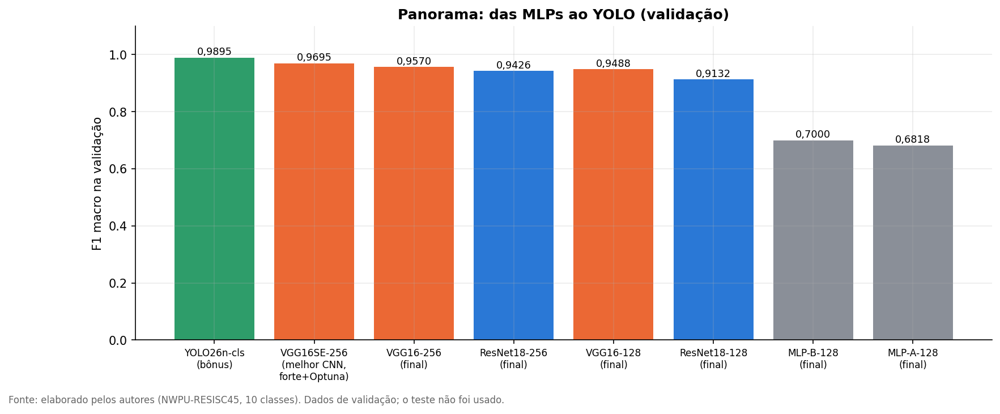

---

## Sumário

1. [O projeto em uma página](#1-o-projeto-em-uma-página)
2. [Dados e preparação](#2-dados-e-preparação)
3. [Arquiteturas (com diagramas)](#3-arquiteturas-com-diagramas)
4. [Como treinamos e quais métricas usamos](#4-como-treinamos-e-quais-métricas-usamos)
5. [Fases do trabalho: exploratória × execuções finais](#5-fases-do-trabalho-exploratória--execuções-finais)
6. [Busca de hiperparâmetros (Optuna)](#6-busca-de-hiperparâmetros-optuna)
7. [Resultados das seis execuções finais](#7-resultados-das-seis-execuções-finais)
8. [Com e sem otimização](#8-com-e-sem-otimização)
9. [Efeito da resolução e custo](#9-efeito-da-resolução-e-custo)
10. [Mecanismos de atenção (SE e CBAM)](#10-mecanismos-de-atenção-se-e-cbam)
11. [Erros e classes confundidas](#11-erros-e-classes-confundidas)
12. [Experimentos exploratórios: aumento de dados e as 112 CNNs](#12-experimentos-exploratórios-aumento-de-dados-e-as-112-cnns)
13. [Bônus: YOLO pré-treinado](#13-bônus-yolo-pré-treinado)
14. [Limitações e cuidados](#14-limitações-e-cuidados)
15. [Repositório, instalação e ordem de execução](#15-repositório-instalação-e-ordem-de-execução)
16. [Estado do projeto e próximos passos](#16-estado-do-projeto-e-próximos-passos)
17. [Equipe e contribuições](#17-equipe-e-contribuições)
18. [Referências](#18-referências)

---

## 1. O projeto em uma página

| Pergunta do PDF | Resposta com os nossos dados (validação) |
|---|---|
| MLP × CNN em 128 × 128 | CNNs muito melhores: F1 macro de **0,913 a 0,949** contra **0,682 e 0,700** das MLPs. A MLP trata a imagem como uma fila de 49.152 números e perde a organização espacial |
| Como a resolução afetou cada CNN | **ResNet18: +2,9 pontos** (0,9132 → 0,9426); **VGG16: +0,8 ponto** (0,9488 → 0,9570) |
| O ganho compensou o custo? | O custo por época sobe **2,5×** (ResNet18) e **3,8×** (VGG16) e o tempo total sobe **2,3×** e **3,7×**. Na ResNet18 o ganho é grande para um custo moderado; na VGG16 o ganho é pequeno para um custo alto |
| Quais classes se confundem | `airport`, `mountain`, `river`, `desert` e `storage_tank` (seção 11) |
| Atenção (SE/CBAM) ajuda? | **Não de forma consistente**: nas ResNets o efeito médio é de +0,8 a +1,2 ponto (instável, de −4,7 a +5,4); nas VGGs é de +0,1 a −1,3 ponto (seção 10) |
| Otimizar hiperparâmetros (Optuna) ajuda? | **Nas MLPs sim** (+3,4 e +9,8 pontos). **Nas CNNs não** (de −0,7 a +0,3 ponto), porque os valores iniciais já eram bons (seção 8). Como chegamos nas configurações das MLPs: seção 7.4 |

**As seis execuções finais (decididas pelo grupo):**

| # | Execução | Receita |
|---|---|---|
| 1 | `MLP-A-128` | aumento leve + hiperparâmetros do Optuna |
| 2 | `MLP-B-128` | aumento leve + hiperparâmetros do Optuna |
| 3 | `ResNet18-128` (CNN A) | aumento leve + hiperparâmetros iniciais |
| 4 | `VGG16-128` (CNN B) | aumento leve + hiperparâmetros iniciais |
| 5 | `ResNet18-256` (CNN A) | a mesma receita da 3, só muda a resolução |
| 6 | `VGG16-256` (CNN B) | a mesma receita da 4, só muda a resolução |

**Por que estas escolhas** (decididas olhando só a validação):

- **CNN A = ResNet18 (blocos residuais) e CNN B = VGG16 (pilha simples):** a hipótese da comparação é "atalhos residuais contra pilha de convoluções" em duas organizações bem diferentes (11,2 M e 14,7 M de parâmetros).
- **Sem atenção nas execuções finais:** as variantes com atenção mudam o resultado de forma irregular (seção 10). Cada variante extra é mais um fator na comparação, sem ganho claro.
- **Mesma receita nas duas resoluções (aumento leve + hiperparâmetros iniciais):** o PDF exige manter lr, semente, otimizador e parada ao passar de 128 para 256, para isolar o efeito da resolução. Os valores do Optuna foram buscados **por resolução** e saíram diferentes em 128 e 256, então não servem para esta comparação. Com os valores iniciais, a resolução melhora as duas CNNs de forma clara.
- **MLPs com Optuna:** só existem em 128, então não há conflito de resolução, e a busca ajudou muito (+3,4 e +9,8 pontos).

> **Estado:** os números das seis execuções abaixo vêm dos treinos preliminares feitos com **exatamente essa receita** (mesmo código, semente 42 e A100; os treinos se repetem com os mesmos resultados na mesma GPU). Falta o retreino final com os nomes finais e a **avaliação única no teste** (seção 16).

---

## 2. Dados e preparação

### 2.1 As dez classes (ordem fixa em todos os modelos, métricas e matrizes)

| # | Pasta original | Classe | O que a imagem mostra |
|---|---|---|---|
| 1 | `airport` | Aeroporto | Pistas extensas e organização das instalações |
| 2 | `beach` | Praia | Faixas de areia e transição entre água e terra |
| 3 | `circular_farmland` | Áreas agrícolas circulares | Geometria circular e repetição espacial |
| 4 | `dense_residential` | Área residencial densa | Concentração de construções e textura urbana |
| 5 | `desert` | Deserto | Superfícies arenosas e pouca vegetação |
| 6 | `forest` | Floresta | Cobertura vegetal e textura das copas |
| 7 | `harbor` | Porto | Água, embarcações e infraestrutura |
| 8 | `mountain` | Montanha | Relevo, sombras e textura irregular |
| 9 | `river` | Rio | Traçados alongados e sinuosos |
| 10 | `storage_tank` | Tanques de armazenamento | Estruturas circulares menores e agrupadas |

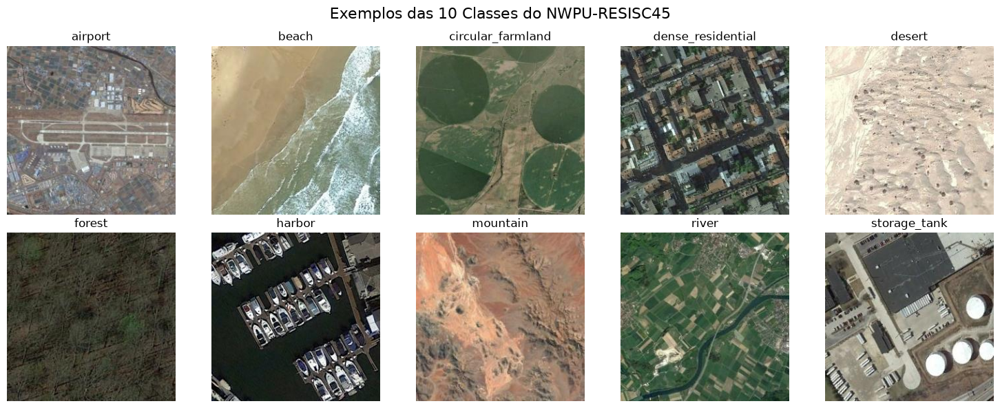

**Ambiguidades visuais** que levantamos *antes* de treinar (hipótese a investigar): praia × rio e deserto × montanha.

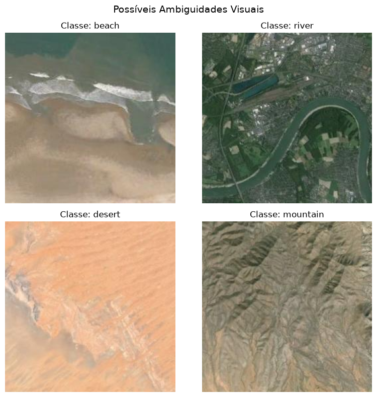

**A mesma cena nas duas resoluções** usadas nos experimentos (a 128 × 128 perde detalhes finos, como marcações de pista e barcos):

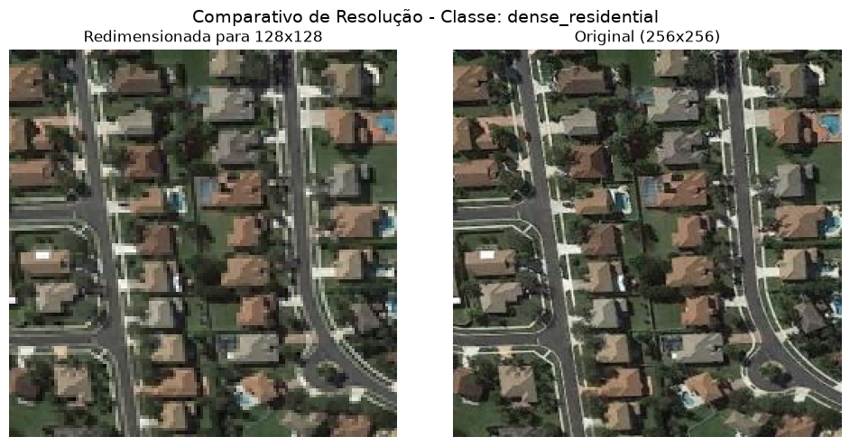

### 2.2 Inventário e qualidade

| Verificação | Resultado |
|---|---|
| Imagens | 7.000, todas legíveis |
| Tamanho e canais | todas `256 × 256`, RGB (3 canais) |
| Duplicatas exatas (MD5) | **6 pares**, todos em `airport`; nenhuma foi excluída |
| Originais | não foram alterados |

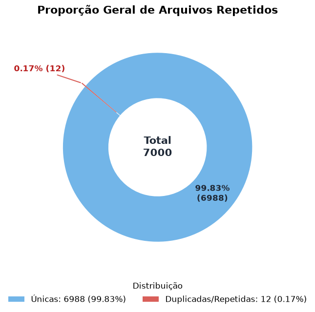
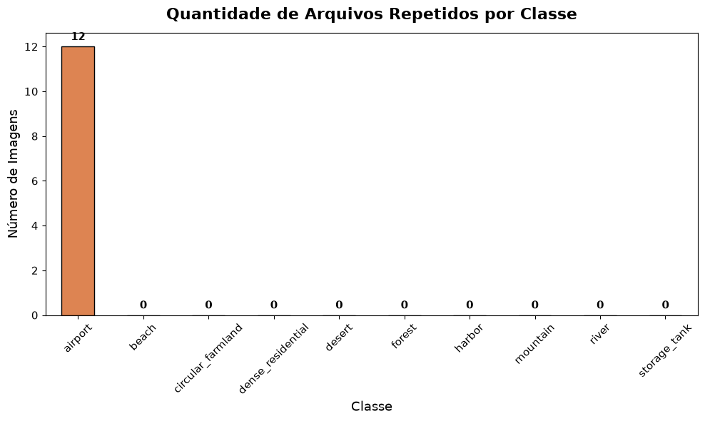

### 2.3 Partições (70 / 15 / 15, estratificadas, semente 42) e prevenção de vazamento

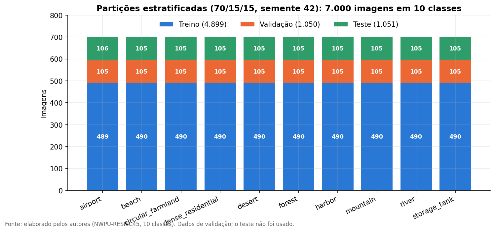

| Classe | Treino | Validação | Teste | Total |
|---|---|---|---|---|
| `airport` | 489 | 105 | 106 | 700 |
| `beach` | 490 | 105 | 105 | 700 |
| `circular_farmland` | 490 | 105 | 105 | 700 |
| `dense_residential` | 490 | 105 | 105 | 700 |
| `desert` | 490 | 105 | 105 | 700 |
| `forest` | 490 | 105 | 105 | 700 |
| `harbor` | 490 | 105 | 105 | 700 |
| `mountain` | 490 | 105 | 105 | 700 |
| `river` | 490 | 105 | 105 | 700 |
| `storage_tank` | 490 | 105 | 105 | 700 |
| **Total** | **4.899** | **1.050** | **1.051** | **7.000** |

| Regra de proteção contra vazamento | Como foi feito |
|---|---|
| Ordem dos caminhos | ordenados **antes** do sorteio |
| Cópias idênticas | agrupadas por hash MD5; o sorteio é feito sobre os **hashes**, então as cópias ficam na mesma partição (por isso `airport` tem 489 / 105 / 106) |
| Mesma divisão em tudo | `dados/splits/particoes.csv` é reutilizado por MLPs, CNNs e YOLO |
| Normalização | média e desvio **calculados só no treino** e reaplicados à validação e ao teste |
| Aumento de dados | **só no treino** |
| Escolhas (hiperparâmetros, checkpoint, parada) | feitas com a **validação** (F1 macro); o teste não é usado |

**Limitação conhecida:** o MD5 só pega cópias idênticas byte a byte. Uma busca por hash perceptual (dHash) achou **5 pares de quase-duplicatas entre partições** (4 em `beach` e 1 em `mountain`). Não corrigimos isso, e ele pode inflar um pouco os resultados dessas duas classes.

### 2.4 Pré-processamento

| Etapa | MLP | CNN |
|---|---|---|
| Cor | RGB | RGB |
| Redimensionamento | a partir do original `256 × 256` para `128 × 128` (bilinear) | para `128 × 128` ou deixa em `256 × 256` |
| Escala | pixels ÷ 255, depois (x − média) ÷ desvio por canal (estatísticas do treino) | igual |
| Formato da entrada | vetor de 49.152 números | tensor `3 × R × R`, sem achatar |

---

## 3. Arquiteturas (com diagramas)

Quatro arquiteturas obrigatórias: **MLP-A, MLP-B** (famílias de camadas densas) e **ResNet18, VGG16** (CNNs), mais as variantes com **atenção** (SE, CBAM, SE + CBAM) que testamos como experimento extra. Todas escritas do zero.

### 3.1 MLP-A × MLP-B

A diferença é a **profundidade**: A tem 2 camadas escondidas e B tem 4. Hipótese: camadas extras ajudam a MLP a combinar melhor os pixels, mas também aumentam o risco de decorar o treino.

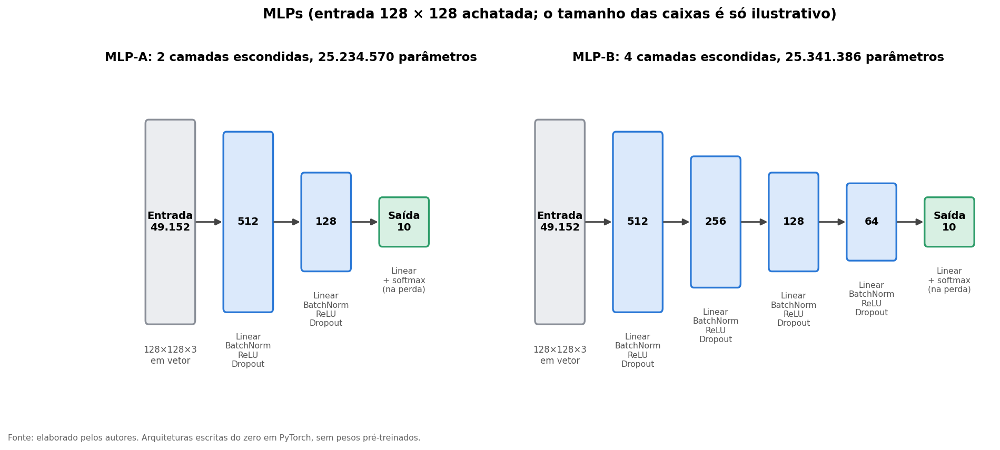

| MLP | Entrada | Bloco de cada camada | Camadas escondidas | Parâmetros | Modelo salvo (MB) |
|---|---|---|---|---|---|
| MLP-A-128 | 49.152 (128×128×3 em vetor) | Linear→BatchNorm→ReLU→Dropout, por camada escondida | 512 → 128 | 25.234.570 | 96,27 |
| MLP-B-128 | 49.152 (128×128×3 em vetor) | Linear→BatchNorm→ReLU→Dropout, por camada escondida | 512 → 256 → 128 → 64 | 25.341.386 | 96,69 |

A entrada com 49.152 números faz a **primeira camada concentrar quase todos os parâmetros** (49.152 × 512 ≈ 25,2 M dos 25,23 M da MLP-A). Por isso as duas MLPs têm quase o mesmo tamanho, apesar da diferença de profundidade.

### 3.2 ResNet18 (CNN A): blocos residuais

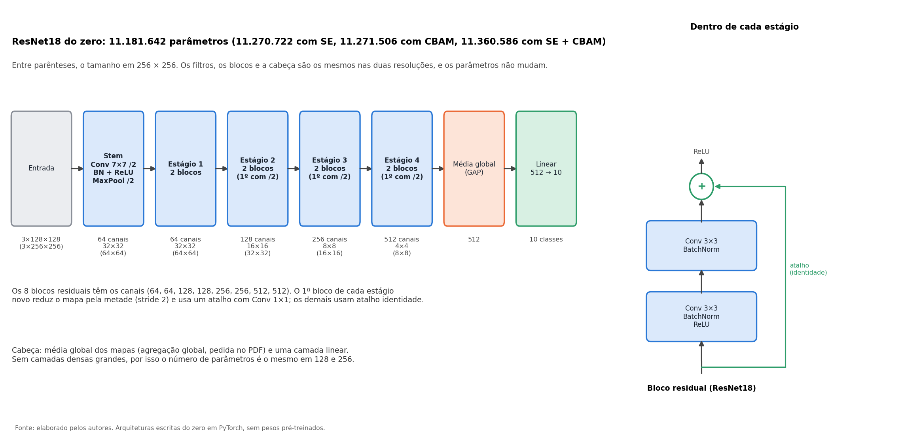

### 3.3 VGG16 com BatchNorm (CNN B): pilha de convoluções

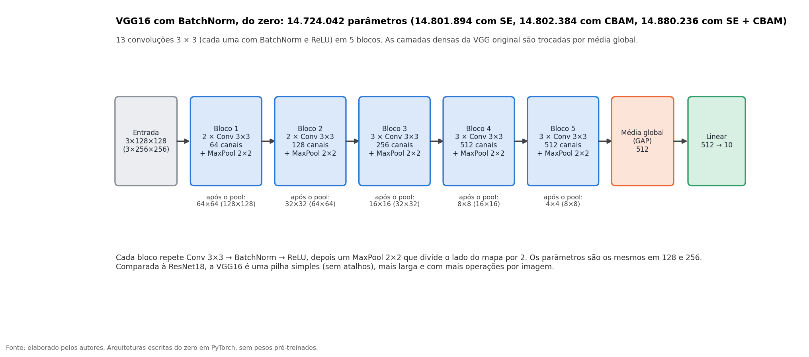

**Hipótese da comparação CNN A × CNN B:** o atalho residual (ResNet18, menos parâmetros e menos operações) treina de forma mais estável, mas a pilha mais larga e profunda da VGG16 pode extrair mais detalhe das texturas. Nas duas, a **agregação global** (média dos mapas) antes da camada de saída faz com que o número de parâmetros seja **o mesmo em 128 e 256**, como o PDF exige.

### 3.4 Mecanismos de atenção (experimento extra)

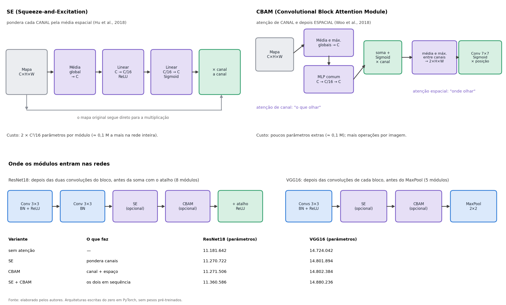

| CNN | Organização | Atenção | Parâmetros (128 e 256) | Acréscimo | Modelo salvo (MB) |
|---|---|---|---|---|---|
| ResNet18 | residual (atalhos) | sem atenção | 11.181.642 | — | 42,73 |
| ResNet18SE | residual (atalhos) | SE (canal) | 11.270.722 | +89.080 (+0,8%) | 43,08 |
| ResNet18CBAM | residual (atalhos) | CBAM (canal + espaço) | 11.271.506 | +89.864 (+0,8%) | 43,09 |
| ResNet18SECBAM | residual (atalhos) | SE + CBAM | 11.360.586 | +178.944 (+1,6%) | 43,44 |
| VGG16 | pilha simples | sem atenção | 14.724.042 | — | 56,23 |
| VGG16SE | pilha simples | SE (canal) | 14.801.894 | +77.852 (+0,5%) | 56,53 |
| VGG16CBAM | pilha simples | CBAM (canal + espaço) | 14.802.384 | +78.342 (+0,5%) | 56,53 |
| VGG16SECBAM | pilha simples | SE + CBAM | 14.880.236 | +156.194 (+1,1%) | 56,84 |

---

## 4. Como treinamos e quais métricas usamos

### 4.1 Protocolo de treino (igual para todas as execuções finais)

| Item | MLP | CNN |
|---|---|---|
| Framework | PyTorch (`torch 2.14.1 + CUDA 13`) | PyTorch |
| Hardware | **GPU NVIDIA A100-SXM4-40GB** (Colab) | a mesma |
| Pesos iniciais | novos (sem pré-treinamento) | novos |
| Função de perda | `CrossEntropyLoss` | `CrossEntropyLoss` |
| Otimizador | **Adam** | **Adam** |
| Taxa de aprendizagem (lr) | do Optuna nas finais (`1,15e-3` e `2,02e-4`); `1e-4` nos treinos iniciais | `1e-4` |
| Weight decay | do Optuna (`7,1e-6` e `2,0e-6`); `1e-4` nos iniciais | `1e-4` |
| Lote | 128 (Optuna); 64 nos iniciais | 64 |
| **Limite de épocas** | **200** | **200** |
| **Parada antecipada** | para após **10 épocas** sem melhora do F1 macro de validação | igual |
| **Checkpoint guardado** | a época com **maior F1 macro de validação** | igual |
| Semente | 42 (Python, NumPy, PyTorch; `cudnn.deterministic`) | igual |
| Aumento de dados (finais) | leve: espelhamentos horizontal e vertical e rotações de 90° | leve |
| Regularização | Dropout (0,2 e 0,3 nas finais com Optuna) + BatchNorm | BatchNorm |

Hiperparâmetros de cada execução final:

| Execução | lr | Weight decay | Lote | Hiperparâmetros | Aumento | Registro em `experimentos.csv` |
|---|---|---|---|---|---|---|
| **MLP-A-128** | 1,15e-03 | 7,1e-06 | 128 | Optuna | leve | `MLP-A-128_aug_opt_preliminar` |
| **MLP-B-128** | 2,02e-04 | 2,0e-06 | 128 | Optuna | leve | `MLP-B-128_aug_opt_preliminar` |
| **ResNet18-128** | 1,00e-04 | 1,0e-04 | 64 | iniciais | leve | `ResNet18-128_preliminar` |
| **VGG16-128** | 1,00e-04 | 1,0e-04 | 64 | iniciais | leve | `VGG16-128_preliminar` |
| **ResNet18-256** | 1,00e-04 | 1,0e-04 | 64 | iniciais | leve | `ResNet18-256_preliminar` |
| **VGG16-256** | 1,00e-04 | 1,0e-04 | 64 | iniciais | leve | `VGG16-256_preliminar` |

### 4.2 Épocas: treino geral × busca de hiperparâmetros

| Etapa | Limite de épocas | Parada antecipada | Para que serve |
|---|---|---|---|
| **Treino geral (execuções finais e exploratórias)** | **200** | 10 épocas sem melhora | produzir o modelo final de cada configuração |
| **Busca de hiperparâmetros, MLP** | **60** por tentativa | 10 épocas sem melhora + poda do Optuna | achar lr, weight decay, dropout e lote |
| **Busca de hiperparâmetros, CNN** | **30** por tentativa | poda do Optuna | idem, com orçamento menor (a CNN é mais cara) |
| Bônus YOLO | 50 | 10 épocas sem melhora | ajuste fino do YOLO pré-treinado |

Na prática, os treinos finais pararam entre **52 e 94 épocas** (tabela da seção 7), bem abaixo do limite de 200.

### 4.3 Aumento de dados (só no treino)

| Receita | O que faz | Uso |
|---|---|---|
| **Sem aumento** | nada | exploratório |
| **Leve** | espelhamento horizontal e vertical (50% cada) e rotação de 0°, 90°, 180° ou 270° | **execuções finais** |
| **Forte** | leve + recorte com zoom (50–100% da área) + brilho, contraste e saturação (±20%) + apagamento aleatório de um retângulo (p = 0,5; 10–40% do lado) | exploratório |

### 4.4 Métricas

| Métrica | O que mede | Onde é usada |
|---|---|---|
| **F1 macro** | média do F1 das 10 classes, sem pesar pelo tamanho da classe | **métrica principal**: escolhe a época do checkpoint, a parada antecipada e as tentativas do Optuna |
| **Acurácia** | fração de imagens certas | métrica secundária (as classes são balanceadas, então fica muito perto do F1 macro) |
| **Precisão, recall e F1 por classe** (e suporte) | desempenho de cada uma das 10 classes | `resultados/metricas_por_classe/` |
| **Matriz de confusão** (contagens e normalizada pela classe real; reais nas linhas e previstas nas colunas) | quais classes se confundem | `resultados/matrizes_confusao/` e figuras |
| **Perda de validação** | quão confiantes e certas são as previsões | curvas e tabelas |
| **Curvas de perda e acurácia por época** (treino e validação) | subajuste e sobreajuste; marcam o checkpoint | `resultados/figuras/` |
| **Custo**: parâmetros, tamanho do modelo salvo (MB), épocas, tempo total e por época | preço de cada modelo | `resultados/experimentos.csv` |

O **tempo** é medido dentro do laço de treino e validação de cada época, **sem** o carregamento dos dados, sempre na mesma A100. Divisão por zero no cálculo de precisão/recall usa `zero_division=0` (não ocorreu nas execuções finais).

---

## 5. Fases do trabalho: exploratória × execuções finais

O PDF permite buscas adicionais, desde que **identificadas separadamente** das seis execuções finais. Nós separamos assim:

| Fase | O que foi feito | Quantidade | Papel |
|---|---|---|---|
| **A. Preparação** | inventário, duplicatas, partições, análise exploratória | — | base de tudo |
| **B. Exploratória (MLPs)** | 2 MLPs × 3 receitas de aumento × 2 rodadas (inicial e Optuna) | 12 treinos | escolher aumento e hiperparâmetros das MLPs |
| **C. Exploratória (busca Optuna)** | busca de hiperparâmetros: MLP (20 tentativas × 2) e CNN (10 tentativas × 4 buscas) + 4 buscas refeitas com aumento forte | 120 tentativas | **parte exploratória**, separada das finais |
| **D. Exploratória (CNNs)** | 8 arquiteturas × 2 resoluções × 2 rodadas × 3 receitas de aumento, mais 16 com o Optuna refeito com aumento forte | **112 treinos** | comparar atenção, aumento, resolução e hiperparâmetros |
| **E. Bônus** | YOLO26n-cls pré-treinado | 1 treino | referência de teto |
| **F. Execuções finais** | MLP-A-128, MLP-B-128, ResNet18 e VGG16 em 128 e em 256 | **6 treinos** | **o que vai para o artigo e para o teste** |

Tudo na **mesma A100**. As fases B, C, D e E só usaram treino e validação.

---

## 6. Busca de hiperparâmetros (Optuna)

> **A busca é a parte exploratória.** Ela serve para **escolher** valores de lr, weight decay, dropout e lote usando só a **validação**. Não é uma das seis execuções finais.

### 6.1 Como a busca foi configurada

| Item | MLP | CNN |
|---|---|---|
| Biblioteca | [Optuna](https://optuna.org) | Optuna |
| Método de amostragem | **TPE**, semente 42 | TPE, semente 42 |
| Poda de tentativas ruins | `MedianPruner` (5 tentativas iniciais sem poda; 10 épocas de aquecimento) | `MedianPruner` (3 sem poda; 5 épocas de aquecimento) |
| **Métrica otimizada** | **F1 macro de validação** (maior valor da tentativa), direção: maximizar | igual |
| **Tentativas por busca** | **20** | **10** |
| **Épocas por tentativa** | **até 60** (parada com 10 épocas sem melhora) | **até 30** |
| Quantas buscas | 2 (MLP-A e MLP-B, em 128) | 4 (ResNet18 e VGG16, em 128 e em 256) |
| Rede usada na busca | a própria MLP | a versão **sem atenção** de cada família; o resultado vale para as variantes |
| Aumento nas tentativas | leve | leve (e depois uma busca refeita com aumento forte) |
| lr | de `1e-5` a `3e-3` (escala log) | idem |
| Weight decay | de `1e-6` a `1e-2` (escala log) | idem |
| Dropout | de 0,2 a 0,7 (passo 0,1) | não se aplica |
| Lote | 32, 64 ou 128 | 32, 64 ou 128 |

### 6.2 O que a busca encontrou

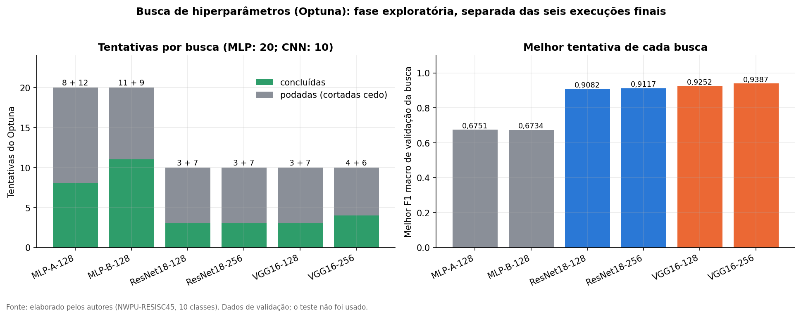

| Busca | Tentativas | Concluídas | Podadas | lr | Weight decay | Dropout | Lote | Melhor F1 val. da busca |
|---|---|---|---|---|---|---|---|---|
| MLP-A-128 | 20 | 8 | 12 | 1,15e-03 | 7,1e-06 | 0,3 | 128 | 0,6751 |
| MLP-B-128 | 20 | 11 | 9 | 2,02e-04 | 2,0e-06 | 0,2 | 128 | 0,6734 |
| ResNet18-128 | 10 | 3 | 7 | 8,47e-05 | 6,4e-03 | — | 32 | 0,9082 |
| ResNet18-256 | 10 | 3 | 7 | 2,43e-05 | 1,7e-06 | — | 32 | 0,9117 |
| VGG16-128 | 10 | 3 | 7 | 2,43e-05 | 1,7e-06 | — | 32 | 0,9252 |
| VGG16-256 | 10 | 4 | 6 | 2,85e-05 | 1,6e-05 | — | 32 | 0,9387 |

- **"Podadas"** são tentativas cortadas cedo porque estavam piores que a mediana. Por isso poucas tentativas das CNNs chegam ao fim (3 ou 4 de 10).
- O "melhor F1 da busca" das CNNs (0,908 a 0,939) fica **abaixo** do F1 dos treinos finais, porque a tentativa para em **30 épocas** e o treino final vai até 200.
- Os valores se repetem entre buscas de CNN porque todas usam a mesma semente (as primeiras tentativas sorteiam os mesmos pontos).

| Histórico das tentativas (MLP) | Importância dos hiperparâmetros (MLP) |
|---|---|
| 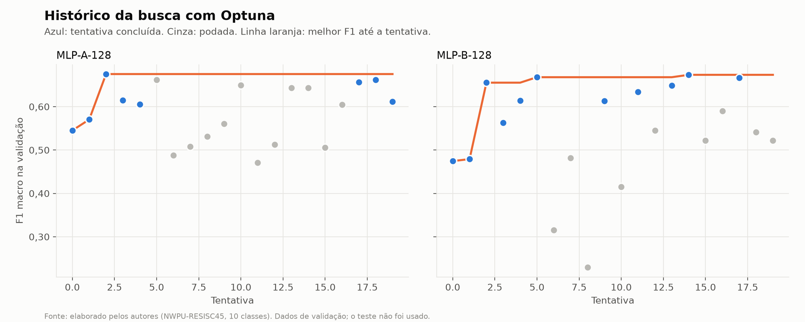 | 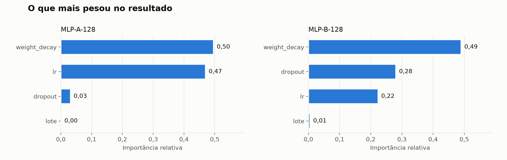 |

| Histórico das tentativas (CNN, 256) | Importância dos hiperparâmetros (CNN, 256) |
|---|---|
| 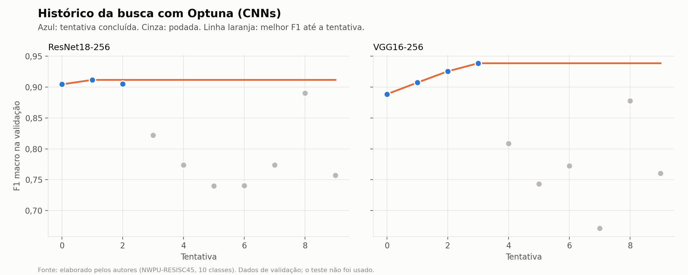 | 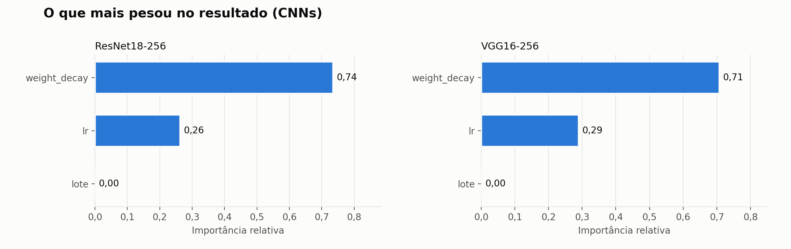 |

### 6.3 Limites da busca

- **Busca pequena** (20 e 10 tentativas, só 3 a 4 concluídas nas CNNs): ela escolhe entre poucos pontos.
- **Orçamento menor que o do treino final** (30 ou 60 épocas contra 200): valores de lr baixo parecem piores na busca e só se recuperam no treino longo.
- **O valor da busca é um máximo de poucas tentativas**, então é otimista.
- A busca da MLP foi feita **no Mac** (primeira execução); só os **retreinos** foram refeitos na A100.
- Para as CNNs, os valores do Optuna **mudam entre 128 e 256**; por isso não os usamos nas execuções finais (o PDF exige manter lr entre resoluções).

---

## 7. Resultados das seis execuções finais

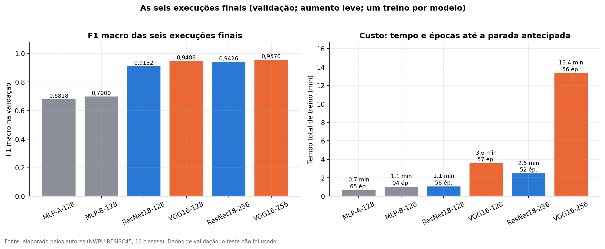

| Execução | Parâmetros | MB | Épocas rodadas | Melhor época | F1 macro | Acurácia | Perda val. | Tempo total (s) | s por época |
|---|---|---|---|---|---|---|---|---|---|
| **MLP-A-128** | 25.234.570 | 96,27 | 65 | 55 | **0,6818** | 0,6857 | 0,8861 | 41,1 | 0,63 |
| **MLP-B-128** | 25.341.386 | 96,69 | 94 | 84 | **0,7000** | 0,7067 | 0,9111 | 63,6 | 0,68 |
| **ResNet18-128** | 11.181.642 | 42,73 | 58 | 48 | **0,9132** | 0,9133 | 0,2765 | 65,4 | 1,13 |
| **VGG16-128** | 14.724.042 | 56,23 | 57 | 47 | **0,9488** | 0,9486 | 0,1723 | 217,1 | 3,81 |
| **ResNet18-256** | 11.181.642 | 42,73 | 52 | 42 | **0,9426** | 0,9429 | 0,1938 | 149,4 | 2,87 |
| **VGG16-256** | 14.724.042 | 56,23 | 56 | 46 | **0,9570** | 0,9571 | 0,1640 | 802,4 | 14,33 |

> Validação, um treino por modelo. Diferenças de poucos décimos de ponto **não** provam superioridade. As curvas de cada execução marcam a época do checkpoint.

### 7.1 F1 por classe

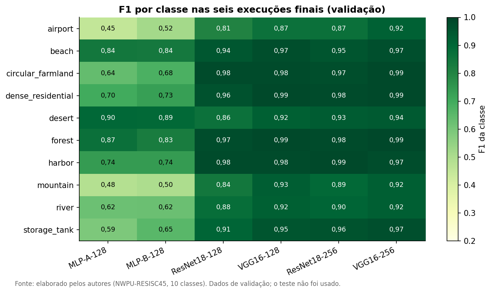

| Classe | MLP-A-128 | MLP-B-128 | ResNet18-128 | VGG16-128 | ResNet18-256 | VGG16-256 |
|---|---|---|---|---|---|---|
| `airport` | 0,451 | 0,516 | 0,806 | 0,865 | 0,869 | 0,917 |
| `beach` | 0,843 | 0,841 | 0,944 | 0,971 | 0,952 | 0,967 |
| `circular_farmland` | 0,635 | 0,680 | 0,981 | 0,981 | 0,971 | 0,986 |
| `dense_residential` | 0,698 | 0,731 | 0,960 | 0,986 | 0,981 | 0,986 |
| `desert` | 0,895 | 0,892 | 0,864 | 0,922 | 0,933 | 0,937 |
| `forest` | 0,866 | 0,826 | 0,972 | 0,986 | 0,981 | 0,990 |
| `harbor` | 0,740 | 0,738 | 0,981 | 0,981 | 0,986 | 0,972 |
| `mountain` | 0,481 | 0,500 | 0,843 | 0,927 | 0,892 | 0,925 |
| `river` | 0,620 | 0,623 | 0,875 | 0,919 | 0,903 | 0,924 |
| `storage_tank` | 0,588 | 0,654 | 0,906 | 0,950 | 0,958 | 0,967 |

### 7.2 Matrizes de confusão (contagens e normalizada pela classe real)

| MLP-A-128 | MLP-B-128 |
|---|---|
| 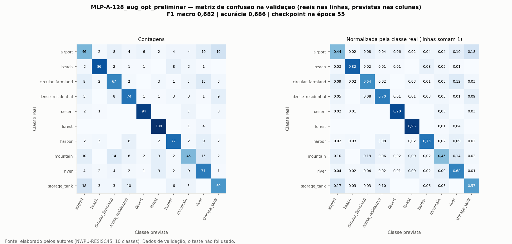 | 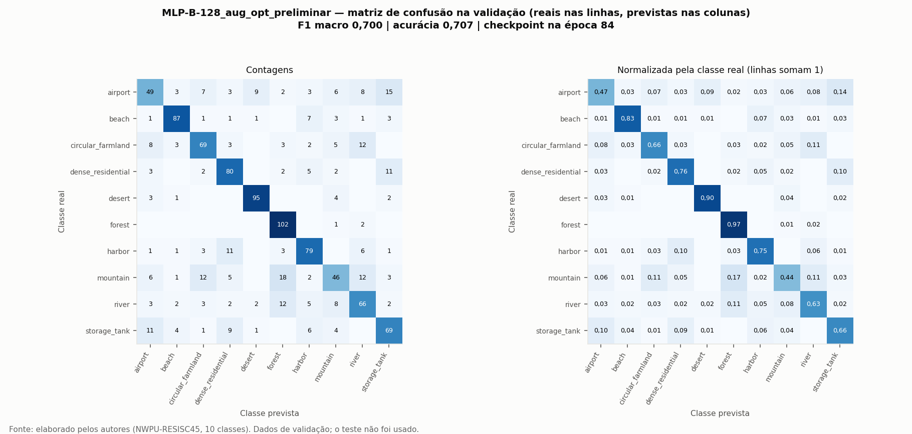 |

| ResNet18-128 | VGG16-128 |
|---|---|
| 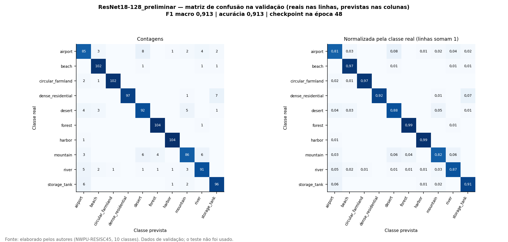 | 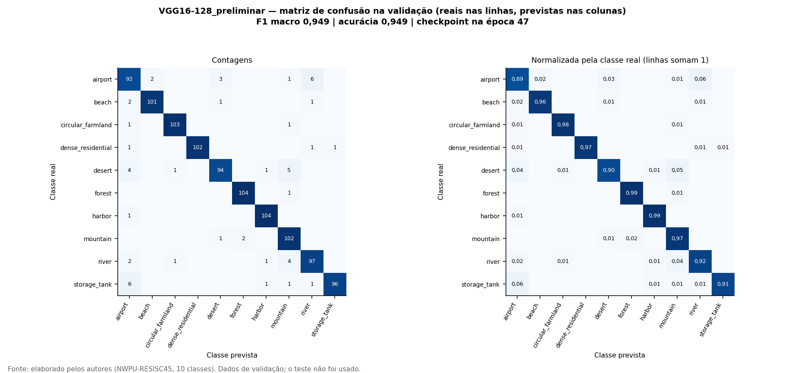 |

| ResNet18-256 | VGG16-256 |
|---|---|
| 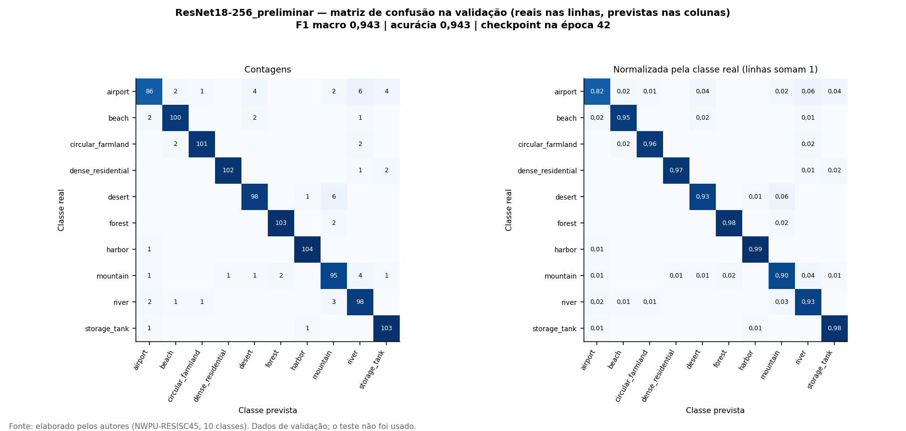 | 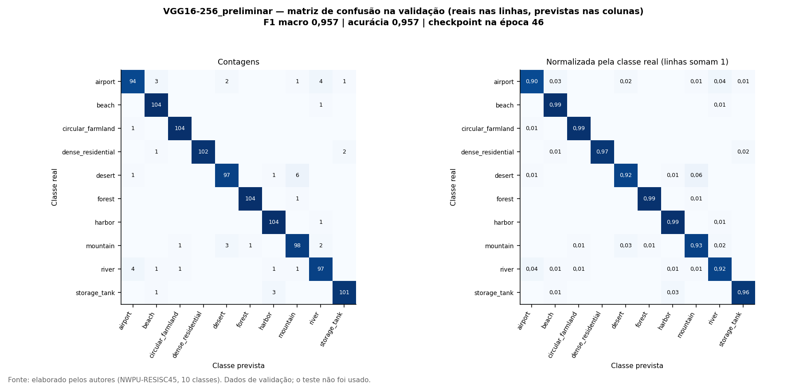 |

### 7.3 Curvas de aprendizagem (perda e acurácia, treino e validação, com o checkpoint)

| MLP-A-128 | MLP-B-128 |
|---|---|
| 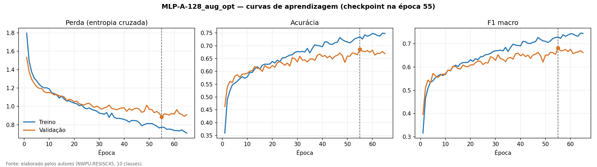 | 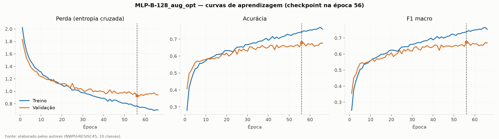 |

| ResNet18-128 | VGG16-128 |
|---|---|
| 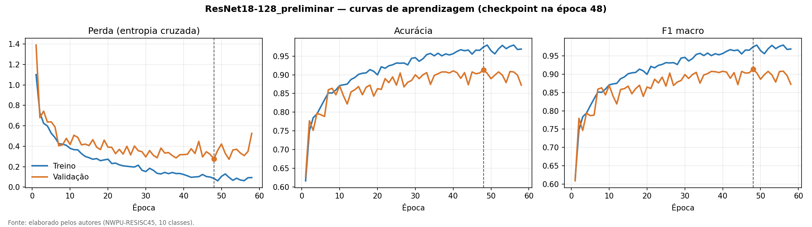 | 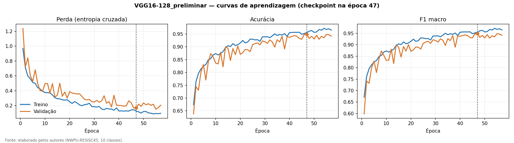 |

| ResNet18-256 | VGG16-256 |
|---|---|
| 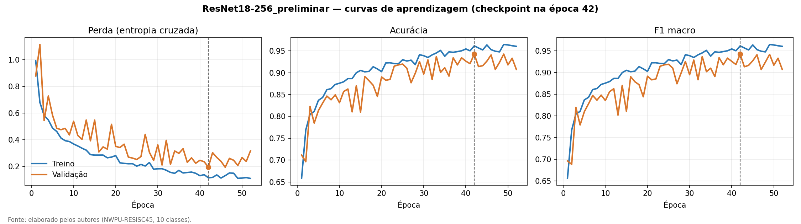 | 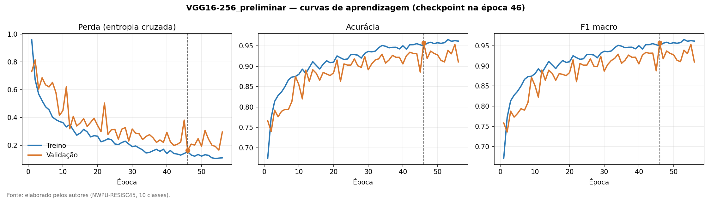 |

**Leitura das curvas** (acurácia no checkpoint, treino × validação):

| Execução | Acurácia de treino | Acurácia de validação | Perda de treino | Perda de validação | Leitura |
|---|---|---|---|---|---|
| MLP-A-128 | 0,735 | 0,686 | 0,773 | 0,886 | acurácia baixa **até no treino**: a MLP não consegue aprender bem a tarefa (limite da arquitetura), com lacuna moderada de ≈ 5 pontos |
| MLP-B-128 | 0,795 | 0,707 | 0,613 | 0,911 | lacuna maior (≈ 9 pontos): começa a decorar o treino, sem melhorar a validação |
| ResNet18-128 | 0,974 | 0,913 | 0,085 | 0,276 | **sobreajuste** (lacuna de ≈ 6 pontos) |
| VGG16-128 | 0,956 | 0,949 | 0,128 | 0,172 | lacuna pequena (≈ 1 ponto) |
| ResNet18-256 | 0,962 | 0,943 | 0,113 | 0,194 | lacuna de ≈ 2 pontos |
| VGG16-256 | 0,950 | 0,957 | 0,154 | 0,164 | sem lacuna (a acurácia de treino é medida com o aumento ligado, por isso fica abaixo) |

As MLPs estagnam perto de 0,70 mesmo com aumento e Optuna. As CNNs convergem mais rápido (checkpoint entre as épocas 42 e 48) e, subindo a resolução, a lacuna entre treino e validação da ResNet18 cai de ≈ 6 para ≈ 2 pontos.

### 7.4 Como chegamos nas MLPs finais: progressão das configurações

As MLPs não nasceram boas. Partimos de uma configuração simples e fomos mudando **uma coisa de cada vez**, sempre olhando o F1 macro de **validação**, até chegar nas configurações das execuções finais. Todos os passos abaixo estão registrados em `resultados/progressao_mlp.csv` (e, linha a linha, em `resultados/experimentos.csv`).

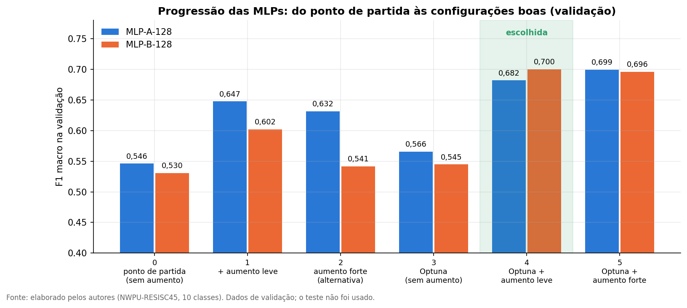

| Passo | O que mudou | MLP | Aumento | Hiperparâmetros | lr | Weight decay | Dropout | Lote | Épocas (melhor) | F1 macro | Δ vs. passo 0 (pt) |
|---|---|---|---|---|---|---|---|---|---|---|---|
| 0 | Ponto de partida: sem aumento, hiperparâmetros escolhidos por nós | MLP-A-128 | nenhum | iniciais | 1,0e-04 | 1,0e-04 | 0,5 | 64 | 27 (17) | 0,5461 | — |
| 0 |  | MLP-B-128 | nenhum | iniciais | 1,0e-04 | 1,0e-04 | 0,5 | 64 | 41 (31) | 0,5305 | — |
| 1 | + aumento leve (espelhar e girar) | MLP-A-128 | leve | iniciais | 1,0e-04 | 1,0e-04 | 0,5 | 64 | 75 (65) | 0,6474 | +10,1 |
| 1 |  | MLP-B-128 | leve | iniciais | 1,0e-04 | 1,0e-04 | 0,5 | 64 | 92 (82) | 0,6020 | +7,2 |
| 2 | Alternativa: aumento forte (zoom, cor, apagamento) | MLP-A-128 | forte | iniciais | 1,0e-04 | 1,0e-04 | 0,5 | 64 | 94 (84) | 0,6316 | +8,6 |
| 2 |  | MLP-B-128 | forte | iniciais | 1,0e-04 | 1,0e-04 | 0,5 | 64 | 50 (40) | 0,5414 | +1,1 |
| 3 | Optuna, sem aumento | MLP-A-128 | nenhum | Optuna | 0,0012 | 7,1e-06 | 0,3 | 128 | 26 (16) | 0,5657 | +2,0 |
| 3 |  | MLP-B-128 | nenhum | Optuna | 2,0e-04 | 2,0e-06 | 0,2 | 128 | 21 (11) | 0,5447 | +1,4 |
| 4 | Optuna + aumento leve  (ESCOLHIDA para as finais) | MLP-A-128 | leve | Optuna | 0,0012 | 7,1e-06 | 0,3 | 128 | 65 (55) | 0,6818 | +13,6 |
| 4 |  | MLP-B-128 | leve | Optuna | 2,0e-04 | 2,0e-06 | 0,2 | 128 | 94 (84) | 0,7000 | +16,9 |
| 5 | Optuna + aumento forte | MLP-A-128 | forte | Optuna | 0,0012 | 7,1e-06 | 0,3 | 128 | 101 (91) | 0,6994 | +15,3 |
| 5 |  | MLP-B-128 | forte | Optuna | 2,0e-04 | 2,0e-06 | 0,2 | 128 | 105 (95) | 0,6959 | +16,5 |

*Épocas (melhor) = épocas rodadas até a parada antecipada e a época do checkpoint. Δ vs. passo 0 em pontos de F1 macro.*

**O que cada passo ensinou:**

| Passo | O que aprendemos |
|---|---|
| 0 → 1 | **O aumento de dados foi o maior salto** (+10,1 pontos na MLP-A e +7,2 na MLP-B). Sem aumento a MLP decora o treino e para cedo (melhor época 17 e 31) |
| 1 → 2 | **Aumento forte com os hiperparâmetros iniciais piorou** em relação ao leve (0,632 contra 0,647 na MLP-A; 0,541 contra 0,602 na MLP-B). A busca de hiperparâmetros veio para tentar consertar isso |
| 2 → Optuna | A busca (20 tentativas por MLP, aumento leve) preferiu **menos dropout** (0,3 e 0,2 em vez de 0,5), **muito menos weight decay** (de 1e-4 para 7e-6 e 2e-6) e **lote maior** (128). O lr ficou maior na MLP-A (1,2e-3) e perto do inicial na MLP-B (2e-4) |
| 3 | **Optuna sem aumento ajuda pouco** (+2,0 e +1,4 pontos): o aumento de dados continua sendo o que mais pesa |
| 4 | **Optuna + aumento leve foi a combinação escolhida** (0,682 e 0,700); a MLP-B passa a ser melhor que a MLP-A, o contrário do que acontecia com os valores iniciais |
| 5 | Optuna + aumento forte ficou **praticamente empatado** com o leve (0,699 e 0,696): a diferença é de 0,4 ponto em um treino, então não dá para separar. Escolhemos o leve por ser a mesma receita das CNNs |

**Importância dos hiperparâmetros na busca** (nota relativa do Optuna):

| | weight decay | lr | dropout | lote |
|---|---|---|---|---|
| MLP-A | 0,50 | 0,47 | 0,03 | 0,00 |
| MLP-B | 0,49 | 0,22 | 0,28 | 0,01 |

O **weight decay** e o **lr** foram o que mais mexeu no resultado; o dropout só pesou na MLP-B (a mais profunda) e o tamanho do lote quase não importou.

**As 5 melhores tentativas de cada busca** (todas as 40 tentativas, com hiperparâmetros, F1 e estado, estão em `resultados/optuna/tentativas_MLP-A-128.csv` e `tentativas_MLP-B-128.csv`):

| Busca | Posição | Tentativa nº | lr | Weight decay | Dropout | Lote | F1 macro (até 60 épocas) |
|---|---|---|---|---|---|---|---|
| MLP-A-128 | 1 | 2 | 0,0012 | 7,1e-06 | 0,3 | 128 | 0,6751 |
| MLP-A-128 | 2 | 18 | 0,003 | 3,3e-06 | 0,2 | 128 | 0,6619 |
| MLP-A-128 | 3 | 17 | 7,3e-04 | 1,1e-06 | 0,2 | 128 | 0,6565 |
| MLP-A-128 | 4 | 3 | 1,2e-04 | 1,5e-05 | 0,5 | 128 | 0,6144 |
| MLP-A-128 | 5 | 19 | 0,0022 | 2,2e-05 | 0,2 | 128 | 0,6113 |
| MLP-B-128 | 1 | 14 | 2,0e-04 | 2,0e-06 | 0,2 | 128 | 0,6734 |
| MLP-B-128 | 2 | 5 | 3,2e-04 | 4,8e-06 | 0,2 | 64 | 0,6679 |
| MLP-B-128 | 3 | 17 | 1,5e-04 | 8,3e-05 | 0,2 | 128 | 0,6662 |
| MLP-B-128 | 4 | 2 | 0,0012 | 7,1e-06 | 0,3 | 128 | 0,6553 |
| MLP-B-128 | 5 | 13 | 5,9e-04 | 1,6e-06 | 0,3 | 64 | 0,6486 |

*Nas buscas, cada tentativa treina até 60 épocas, por isso o F1 da busca (0,675 e 0,673) fica abaixo do treino completo (0,682 e 0,700 com até 200 épocas). A busca foi feita no Mac; os retreinos foram na A100.*

Mais detalhes (curvas, sobreajuste e comparação Mac × A100): [`docs/MLP.md`](docs/MLP.md).

---

## 8. Com e sem otimização

"**Sem otimização**" = hiperparâmetros que **nós** escolhemos (lr `1e-4`, weight decay `1e-4`, lote 64, dropout 0,5 nas MLPs). "**Com otimização**" = hiperparâmetros achados pelo Optuna. Mesma receita de aumento (leve) nas duas colunas.

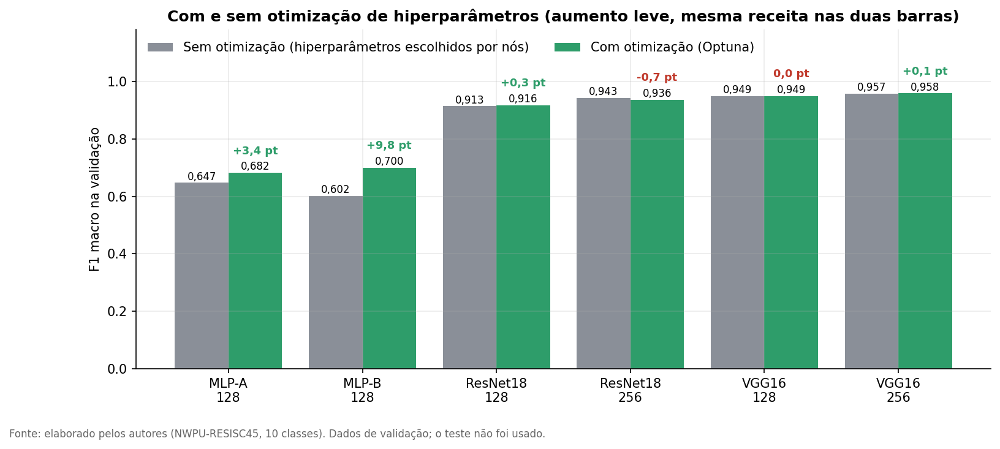

| Modelo (aumento leve) | F1 sem otimização | F1 com Optuna | Diferença | Épocas sem | Épocas com |
|---|---|---|---|---|---|
| MLP-A-128 | 0,6474 | 0,6818 | +3,4 pt | 75 | 65 |
| MLP-B-128 | 0,6020 | 0,7000 | +9,8 pt | 92 | 94 |
| ResNet18-128 | 0,9132 | 0,9164 | +0,3 pt | 58 | 48 |
| ResNet18-256 | 0,9426 | 0,9356 | -0,7 pt | 52 | 50 |
| VGG16-128 | 0,9488 | 0,9487 | 0,0 pt | 57 | 61 |
| VGG16-256 | 0,9570 | 0,9579 | +0,1 pt | 56 | 56 |

| O que vimos | Leitura |
|---|---|
| **MLPs: o Optuna ajuda muito** (+3,4 e +9,8 pontos) | a MLP é sensível a lr, dropout e weight decay. Os valores iniciais (dropout 0,5 em todas as camadas) provavelmente eram fortes demais para a MLP-B, que tem 4 camadas com dropout (hipótese; o Optuna escolheu dropout 0,2 e 0,3) |
| **CNNs: o Optuna quase não muda nada** (−0,7 a +0,3 ponto) | os valores iniciais (lr `1e-4`, Adam) já eram bons para BatchNorm + CNN; a busca de 10 tentativas não achou algo melhor |
| Com Optuna, a MLP-B (a mais profunda) passa a MLP-A (0,700 × 0,682) | sem otimização, a MLP-B ia pior (0,602 × 0,647): a ordem entre A e B **depende dos hiperparâmetros** |

Mesmo comparação em todas as 12 MLPs (as 3 receitas de aumento, com e sem Optuna):

| MLP | Aumento | F1 inicial | Acurácia | Épocas | F1 Optuna | Acurácia | Épocas |
|---|---|---|---|---|---|---|---|
| MLP-A-128 | sem aumento | 0,5461 | 0,5543 | 27 | 0,5657 | 0,5686 | 26 |
| MLP-B-128 | sem aumento | 0,5305 | 0,5505 | 41 | 0,5447 | 0,5524 | 21 |
| MLP-A-128 | leve | 0,6474 | 0,6610 | 75 | 0,6818 | 0,6857 | 65 |
| MLP-B-128 | leve | 0,6020 | 0,6124 | 92 | 0,7000 | 0,7067 | 94 |
| MLP-A-128 | forte | 0,6316 | 0,6495 | 94 | 0,6994 | 0,7105 | 101 |
| MLP-B-128 | forte | 0,5414 | 0,5695 | 50 | 0,6959 | 0,7076 | 105 |

---

## 9. Efeito da resolução e custo

Mesmas arquiteturas, mesmos hiperparâmetros, mesma GPU; **muda só a resolução**.

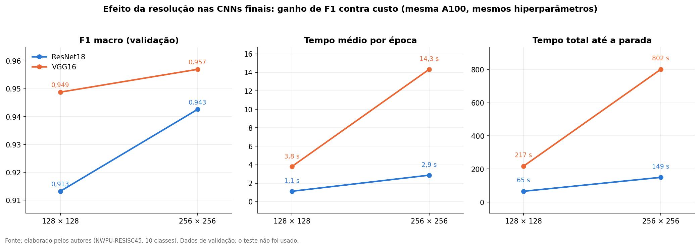

| CNN | F1 em 128 | F1 em 256 | Ganho | Tempo por época | Custo/época | Tempo total | Custo total | Parâmetros (iguais) |
|---|---|---|---|---|---|---|---|---|
| ResNet18 | 0,9132 | 0,9426 | +2,9 pt | 1,1 → 2,9 s | 2,5x | 65 → 149 s | 2,3x | 11.181.642 |
| VGG16 | 0,9488 | 0,9570 | +0,8 pt | 3,8 → 14,3 s | 3,8x | 217 → 802 s | 3,7x | 14.724.042 |

| Pergunta do PDF | Resposta |
|---|---|
| A resolução afetou cada CNN? | **Sim, nas duas.** A ResNet18 ganhou mais (+2,9 pontos) do que a VGG16 (+0,8 ponto) |
| Os ganhos compensaram o custo? | **ResNet18: sim** (ganho de quase 3 pontos por cerca de 2,3× o tempo). **VGG16: pouco** (menos de 1 ponto por cerca de 3,7× o tempo, 13 minutos de treino) |
| Por que a ResNet18 ganha mais? | em 128 ela já parte de um F1 menor (0,913). O F1 por classe sobe mais em `airport` (0,806 → 0,869), `storage_tank` (0,906 → 0,958) e `mountain` (0,843 → 0,892), classes que dependem de detalhes finos (hipótese: pistas, tanques e relevo). A VGG16, mais larga, já extrai bastante em 128 |
| E o número de parâmetros? | idêntico nas duas resoluções (agregação global), então o custo extra vem só do tamanho dos mapas |

Com a ResNet18 em 256 (0,9426) a diferença para a VGG16 em 128 (0,9488) é pequena, mas a ResNet18-256 treina em **149 s** contra **217 s** da VGG16-128.

---

## 10. Mecanismos de atenção (SE e CBAM)

Testamos **SE** (atenção de canal), **CBAM** (canal + espaço) e **SE + CBAM** em cima da ResNet18 e da VGG16, em 128 e 256. A pergunta era se "olhar melhor" para canais e regiões compensa o custo (+0,5 a +1,6% de parâmetros e mais operações por imagem). Foram testados como **experimento extra**; as execuções finais usam as redes sem atenção.

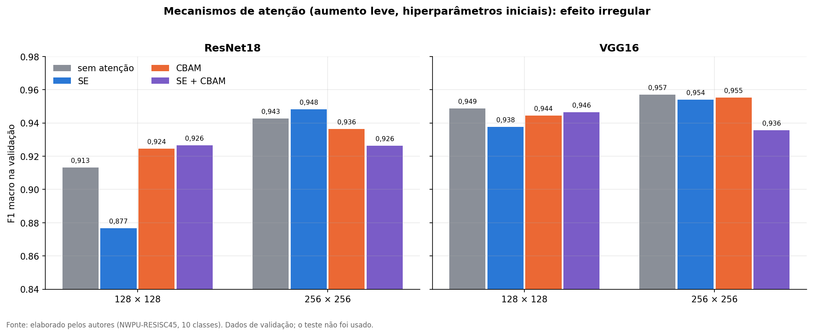

Aumento leve, hiperparâmetros iniciais. Δ é a diferença para a mesma família sem atenção, na mesma resolução:

| CNN | F1 128 | Δ vs. base (pt) | F1 256 | Δ vs. base (pt) | s/época (256) | Parâmetros |
|---|---|---|---|---|---|---|
| ResNet18 | 0,9132 | — | 0,9426 | — | 2,9 | 11.181.642 |
| ResNet18SE | 0,8766 | -3,7 | 0,9481 | +0,6 | 3,1 | 11.270.722 |
| ResNet18CBAM | 0,9245 | +1,1 | 0,9364 | -0,6 | 3,9 | 11.271.506 |
| ResNet18SECBAM | 0,9265 | +1,3 | 0,9262 | -1,6 | 4,2 | 11.360.586 |
| VGG16 | 0,9488 | — | 0,9570 | — | 14,3 | 14.724.042 |
| VGG16SE | 0,9377 | -1,1 | 0,9539 | -0,3 | 15,9 | 14.801.894 |
| VGG16CBAM | 0,9444 | -0,4 | 0,9552 | -0,2 | 20,7 | 14.802.384 |
| VGG16SECBAM | 0,9464 | -0,2 | 0,9356 | -2,1 | 22,3 | 14.880.236 |

Para não depender de um único cenário, comparamos cada variante com a base em **12 pares** (2 resoluções × 2 rodadas de hiperparâmetros × 3 receitas de aumento):

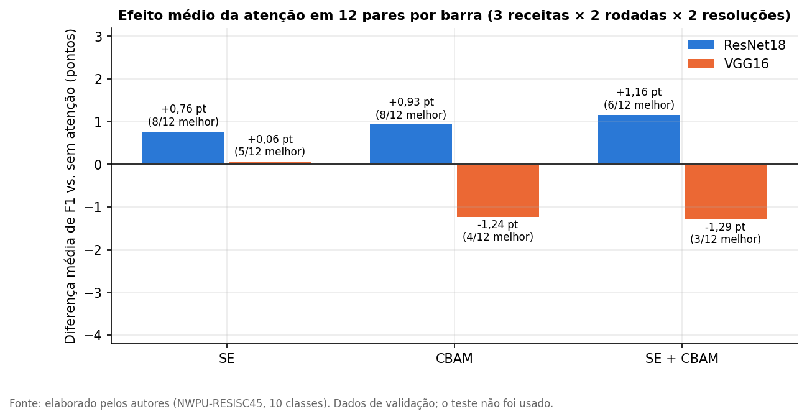

| Família | Variante | Efeito médio | Melhora em | Pior caso (pt) | Melhor caso (pt) |
|---|---|---|---|---|---|
| ResNet18 | SE | +0,76 pt | 8 de 12 | -4,5 | +3,6 |
| ResNet18 | CBAM | +0,93 pt | 8 de 12 | -4,7 | +5,4 |
| ResNet18 | SE + CBAM | +1,16 pt | 6 de 12 | -1,6 | +4,9 |
| VGG16 | SE | +0,06 pt | 5 de 12 | -1,8 | +3,9 |
| VGG16 | CBAM | -1,23 pt | 4 de 12 | -4,4 | +1,7 |
| VGG16 | SE + CBAM | -1,29 pt | 3 de 12 | -4,0 | +1,4 |

**Conclusões (com as limitações de um treino por configuração):**

- **VGG16:** a atenção **não ajudou** (SE ≈ 0; CBAM e SE + CBAM pioram cerca de 1,2 ponto em média e vencem em só 3 a 4 de 12 pares).
- **ResNet18:** a atenção melhora em média **+0,8 a +1,2 ponto**, mas de forma **instável**: o pior caso é −4,7 e o melhor +5,4 pontos, e a SE em 128 *piorou* 3,7 pontos (o treino parou cedo, na época 8).
- **Custo:** a atenção acrescenta de 0,5% a 1,6% de parâmetros, mas o tempo por época da VGG16 em 256 sobe de 14,3 s (base) para 15,9 s (SE), 20,7 s (CBAM) e 22,3 s (SE + CBAM).
- O melhor modelo geral entre as CNNs usa SE (**VGG16SE-256, F1 0,9695**, com aumento forte + Optuna), mas a diferença para a VGG16 sem atenção treinada igual (0,9542 com forte + Optuna) é de cerca de 1,5 ponto em *uma* execução, e a mesma SE piora em outros cenários. Não tratamos isso como evidência de que a SE é melhor.
- **Decisão:** manter as execuções finais sem atenção, para a comparação principal ser limpa, e reportar a atenção como resultado exploratório com cuidado.

---

## 11. Erros e classes confundidas

| Execução | Acertos | Maiores confusões (real → prevista, nº de imagens) |
|---|---|---|
| **MLP-A-128** | 720 de 1050 | `airport`→`storage_tank` (19) · `storage_tank`→`airport` (18) · `mountain`→`river` (15) |
| **MLP-B-128** | 742 de 1050 | `mountain`→`forest` (18) · `airport`→`storage_tank` (15) · `river`→`forest` (12) |
| **ResNet18-128** | 959 de 1050 | `airport`→`desert` (8) · `dense_residential`→`storage_tank` (7) · `storage_tank`→`airport` (6) |
| **VGG16-128** | 996 de 1050 | `storage_tank`→`airport` (6) · `airport`→`river` (6) · `desert`→`mountain` (5) |
| **ResNet18-256** | 990 de 1050 | `desert`→`mountain` (6) · `airport`→`river` (6) · `mountain`→`river` (4) |
| **VGG16-256** | 1005 de 1050 | `desert`→`mountain` (6) · `river`→`airport` (4) · `airport`→`river` (4) |

**O que as matrizes mostram:**

- **MLPs:** erram **cerca de 30% das imagens** (31% e 29%); confundem `airport` × `storage_tank` (19 e 18 imagens) e `mountain` com `river`, `forest` e `circular_farmland`. Sem noção de forma, a MLP depende de cor e textura média (hipótese).
- **CNNs:** erram **de 4% a 9%** das imagens e os erros se concentram em poucos pares: **`desert` → `mountain`** (5 ou 6 imagens em todas as CNNs; terreno árido e relevo se parecem de cima), **`airport` ↔ `river`, `storage_tank` e `desert`** (grandes superfícies pavimentadas ou alongadas lembram rios, e tanques isolados lembram parte de um aeroporto; hipóteses visuais, ainda sem inspeção imagem a imagem) e `mountain` → `river`.
- **Resolução:** subir para 256 melhora o F1 de `airport`, `storage_tank` e `mountain` na ResNet18 (seção 9); na VGG16 `desert` → `mountain` continua em 6 imagens.
- As classes **`forest`, `harbor`, `circular_farmland` e `dense_residential`** são quase sempre acertadas pelas CNNs (F1 de 0,96 a 0,99).
- A hipótese que levantamos antes do treino (praia × rio e deserto × montanha) se confirmou **em parte**: `desert` → `mountain` aparece nas matrizes; `beach` × `river` quase não (no máximo 2 imagens por modelo).
- **Generalização:** não testamos outras regiões, sensores, estações do ano ou ângulos de captura; os resultados descrevem só estas partições do RESISC45 e **não garantem** o mesmo desempenho fora delas.

> A análise de **erros de teste** (até seis imagens do modelo de maior F1 de validação, com classe real, prevista e confiança) será feita junto com a avaliação única no teste.

---

## 12. Experimentos exploratórios: aumento de dados e as 112 CNNs

Além das seis execuções finais, treinamos **112 CNNs** (todas as 8 arquiteturas, em 128 e 256) para entender o efeito do aumento de dados, dos hiperparâmetros e da atenção. **Nada disso entra na tabela final**, mas orienta as escolhas.

Média do F1 macro de validação das 8 CNNs em cada célula:

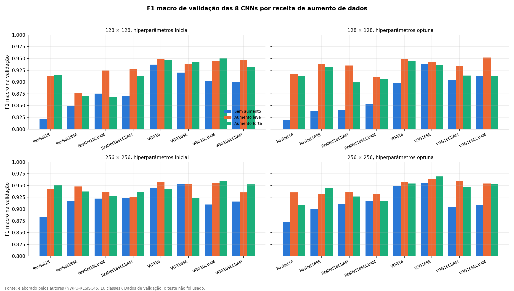

| Resolução | Hiperparâmetros | Sem aumento | Aumento leve | Aumento forte |
|---|---|---|---|---|
| 128 | inicial | 0,8841 | 0,9273 | 0,9171 |
| 128 | Optuna | 0,8756 | 0,9346 | 0,9195 |
| 256 | inicial | 0,9214 | 0,9444 | 0,9413 |
| 256 | Optuna | 0,9147 | 0,9465 | 0,9399 |

| O que vimos | Leitura |
|---|---|
| **Sem aumento é sempre pior que o leve** (32 de 32 pares; −3,9 pontos em média) | provavelmente a CNN decora as 4.899 imagens de treino sem o aumento (hipótese) |
| **O aumento forte ficou, em média, 0,9 ponto abaixo do leve** (23 piores, 9 melhores) | hipótese: zoom, cor e apagamento dificultam o treino sem ajudar muito quando as imagens já são viradas e giradas |
| O melhor treino de todos usa o forte (VGG16SE-256, 0,9695), contra 0,9645 do melhor com o leve | diferença de 0,5 ponto em uma execução: é ruído |
| **Os valores do Optuna não se transferem entre receitas** | a busca feita com aumento leve piora o treino sem aumento e não ajuda o forte |
| **Refazer o Optuna com aumento forte não ajudou** | as ResNets repetiram os mesmos valores; as VGGs ficaram de 0,4 a 0,7 ponto abaixo |

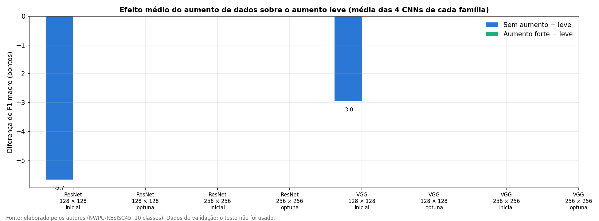

**Os 10 melhores treinos de CNN** (todos VGGs em 256):

| # | CNN | Res. | Aumento | Hiperparâmetros | F1 | Acurácia | Tempo (s) |
|---|---|---|---|---|---|---|---|
| 1 | VGG16SE | 256 | forte | Optuna | 0,9695 | 0,9695 | 1501,0 |
| 2 | VGG16SE | 256 | forte | Optuna (refeito c/ forte) | 0,9694 | 0,9695 | 1656,3 |
| 3 | VGG16SE | 256 | leve | Optuna | 0,9645 | 0,9648 | 1151,8 |
| 4 | VGG16CBAM | 256 | forte | inicial | 0,9597 | 0,9600 | 1300,2 |
| 5 | VGG16CBAM | 256 | leve | Optuna | 0,9590 | 0,9590 | 1779,8 |
| 6 | VGG16 | 256 | leve | Optuna | 0,9579 | 0,9581 | 792,3 |
| 7 | VGG16 | 256 | leve | inicial | 0,9570 | 0,9571 | 802,4 |
| 8 | VGG16CBAM | 256 | leve | inicial | 0,9552 | 0,9552 | 1036,6 |
| 9 | VGG16SE | 256 | sem aumento | Optuna | 0,9550 | 0,9552 | 780,8 |
| 10 | VGG16 | 256 | forte | Optuna | 0,9542 | 0,9543 | 813,3 |

Detalhes de todos os 112 treinos, tabelas por bloco, curvas e matrizes: [`docs/CNN.md`](docs/CNN.md). MLPs: [`docs/MLP.md`](docs/MLP.md).

---

## 13. Bônus: YOLO pré-treinado

O PDF permite pré-treinamento **apenas no bônus**. Ajustamos o **YOLO26n-cls** (pré-treinado no ImageNet) nas mesmas partições, em 256 × 256.

| | VGG16SE-256 (melhor CNN do zero) | YOLO26n-cls-256 |
|---|---|---|
| F1 macro (validação) | 0,9695 | **0,9895** |
| Parâmetros | 14.801.894 | 1.543.914 |
| Modelo salvo | 56,53 MB | 3,06 MB |
| Épocas até o checkpoint | 83 | 24 |
| Tempo total | 1501 s | 243 s |
| Pesos iniciais | novos | pré-treinados |

O YOLO ganha em desempenho **e** custo, mas a comparação **não isola a arquitetura**: ele leva pré-treinamento, otimizador e aumento diferentes dos nossos. Detalhes em [`docs/YOLO.md`](docs/YOLO.md).

| | | |
|---|---|---|
| 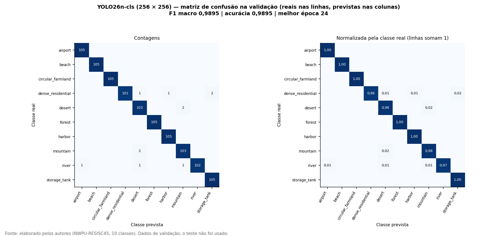 | 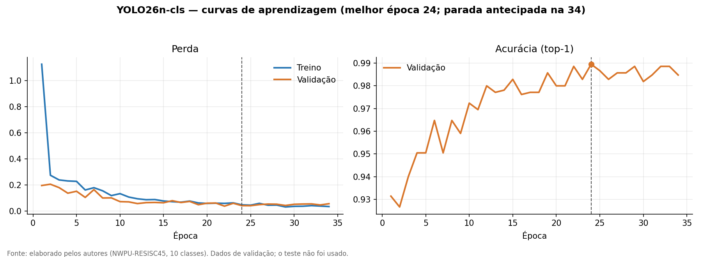 | 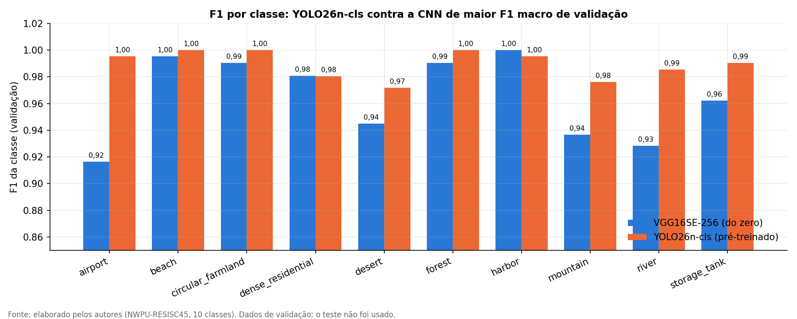 |

---

## 14. Limitações e cuidados

| Limitação | O que significa |
|---|---|
| **Um treino por configuração** | não medimos desvio entre sementes; diferenças de ≈ 1 ponto são ruído. O desvio mostrado por classe **não** é desvio entre sementes |
| **Seleção na validação** | as escolhas (receita, checkpoint) usam a validação; o F1 de validação é um pouco otimista. O teste, avaliado uma vez, dirá o quanto |
| **Quase-duplicatas entre partições** | 5 pares (4 em `beach`, 1 em `mountain`) escaparam do MD5 |
| **Busca de hiperparâmetros pequena** | 20 e 10 tentativas, com orçamento menor de épocas; só 3 a 4 tentativas concluídas por busca das CNNs |
| **Optuna das CNNs feito com aumento leve** | os valores foram aplicados sem nova busca às outras receitas (exceto o refeito com forte) |
| **Atenção testada sem busca própria** | usou os valores da rede sem atenção |
| **Hardware** | MLPs, CNNs e YOLO treinaram na mesma A100; a busca das MLPs foi feita no Mac e só os retreinos foram refeitos na A100. Poucas predições diferem entre CPU e GPU na avaliação (9 em 100.800 e 2 em 16.800), sem mudar F1 nem acurácia |
| **Generalização** | não testamos outras regiões nem condições de captura |

---

## 15. Repositório, instalação e ordem de execução

```text
.
├── README.md                 # este documento
├── requirements.txt
├── dados/
│   ├── raw/                  # originais (não versionados) ou instruções de obtenção
│   └── splits/particoes.csv  # arquivo, classe e partição
├── notebooks/                # 01 análise exploratória · 02 MLPs · 03 CNNs e YOLO
├── src/                      # scripts reutilizáveis (treino na GPU, avaliação, gráficos, diagramas)
├── modelos/                  # checkpoints (não versionados; ver docs/PROGRESSO.md)
├── resultados/
│   ├── experimentos.csv      # uma linha por treino (MLPs, CNNs e YOLO)
│   ├── historicos/  configs/  matrizes_confusao/  metricas_por_classe/
│   ├── previsoes_validacao_{mlp,cnn}.csv
│   ├── progressao_mlp.csv    # progressão das configurações das MLPs, do ponto de partida às boas
│   ├── optuna/               # tentativas e melhores hiperparâmetros
│   ├── yolo/
│   └── figuras/              # eda/ arquiteturas/ resumo/ mlp/ cnn/ yolo/
└── docs/                     # MLP.md · CNN.md · YOLO.md · PROGRESSO.md · acompanhamento.pdf (documento A4)
```

**Versões:** Python 3, `torch 2.14.1+cu130`, `torchvision`, `numpy`, `pandas`, `scikit-learn`, `pillow`, `matplotlib`, `optuna ≥ 3.6`, `ultralytics 8.4.216` (bônus). Lista mínima em `requirements.txt`.

```bash
python -m venv .venv
source .venv/bin/activate          # Windows: .venv\Scripts\Activate.ps1
pip install -r requirements.txt
```

> Em máquinas com GPU NVIDIA, instale antes o PyTorch com a versão de CUDA do seu driver (veja [pytorch.org](https://pytorch.org/get-started/locally/)). No Colab o PyTorch com CUDA já vem instalado.

**Dados:** baixar o NWPU-RESISC45, colocar em `dados/raw/NWPU-RESISC45/` e manter só as 10 classes (`python src/setup_dataset.py`). Usamos o espelho do Kaggle `aqibrehmanpirzada/nwpuresisc45` (juntando as pastas de treino e de teste para recuperar as 700 imagens por classe; **a divisão usada é a do projeto**, não a do Kaggle).

**Ordem de execução:**

1. `python src/setup_dataset.py` — mantém só as 10 classes.
2. `python src/check_integrity.py` — inventário, RGB, duplicatas (gera `resultados/inventario_dados.csv`).
3. `python src/create_splits.py` — partições 70/15/15 com semente 42 (gera `dados/splits/particoes.csv`).
4. `notebooks/01_analise_exploratoria.ipynb` — exploração.
5. `notebooks/02_mlp_preliminar.ipynb` e `python src/rodar_mlps_a100.py` — MLPs e Optuna das MLPs.
6. `notebooks/03_CNNs.ipynb` — CNNs, Optuna das CNNs e YOLO; `python src/rodar_cnns_aumentos.py <128|256>` e `python src/optuna_cnns_aumento_forte.py <128|256>` — variações de aumento.
7. `python src/avaliar_cnn_validacao.py` e `python src/avaliar_yolo_validacao.py` — matrizes, métricas por classe e previsões.
8. Gráficos: `python src/graficos_mlp.py`, `graficos_cnn.py`, `graficos_cnn_aumentos.py`, `graficos_yolo.py`, `graficos_arquiteturas.py` e `graficos_resumo.py` (este também gera `resultados/progressao_mlp.csv`).
   Documento do acompanhamento: `python src/gerar_acompanhamento.py` (gera `docs/acompanhamento.pdf`; precisa do Google Chrome).
9. *(a fazer)* avaliação das seis execuções finais no **teste, uma única vez**.

**Reprodutibilidade:** semente 42 em tudo, `cudnn.deterministic`; repetir um treino na mesma A100 reproduz F1, acurácia e época do checkpoint. Na A100 do Colab, os 112 treinos de CNN somam cerca de **11,9 horas** de treino e os 12 das MLPs cerca de **10,6 minutos**.

---

## 16. Estado do projeto e próximos passos

| Item | Estado |
|---|---|
| Dados, partições, análise exploratória e duplicatas | pronto |
| MLPs (12 treinos), CNNs (112 treinos), Optuna e YOLO | pronto (validação) |
| Decisão das seis execuções finais | **decidida** (seção 1) |
| Retreino final com os nomes finais (6 treinos) | a fazer |
| **Avaliação única no teste** (acurácia, F1 macro, métricas por classe, matrizes, até 6 erros) | a fazer |
| Artigo (`docs/artigo.pdf`), pitch (`docs/pitch.pdf`) | a fazer |
| Documento do acompanhamento (PDF, A4) | [`docs/acompanhamento.pdf`](docs/acompanhamento.pdf)  |
| Modelos em armazenamento externo com link (checkpoints: 5,5 GB de CNNs e 1,2 GB de MLPs) | a fazer |

Mais detalhes, custos e como retomar o treino: [`docs/PROGRESSO.md`](docs/PROGRESSO.md).

---

## 17. Equipe e contribuições

| Integrante | Contribuições no projeto |
|---|---|
| João Igor Vidal de Andrade | CNNs: ResNet18 e VGG16 (e variantes com atenção), treinos em 128 e 256, busca de hiperparâmetros das CNNs e comparação de resolução e custo |
| Amanda Lira | Análise exploratória dos dados e limpeza dos dados (integridade, duplicatas, ambiguidades visuais e comparação de resoluções) |
| Raquel Albuquerque Quirino | Análise exploratória dos dados; criação dos documentos e do artigo; organização das tarefas do projeto |
| Sofya Oliveira | MLPs: MLP-A e MLP-B, treinos em 128 e busca de hiperparâmetros das MLPs |

---

## 18. Referências

- CHENG, G.; HAN, J.; LU, X. Remote sensing image scene classification: benchmark and state of the art. *Proceedings of the IEEE*, v. 105, n. 10, p. 1865–1883, 2017. (NWPU-RESISC45)
- HE, K. et al. Deep residual learning for image recognition. *CVPR*, 2016. (ResNet)
- SIMONYAN, K.; ZISSERMAN, A. Very deep convolutional networks for large-scale image recognition. *ICLR*, 2015. (VGG)
- HU, J.; SHEN, L.; SUN, G. Squeeze-and-excitation networks. *CVPR*, 2018. (SE)
- WOO, S. et al. CBAM: convolutional block attention module. *ECCV*, 2018.
- IOFFE, S.; SZEGEDY, C. Batch normalization: accelerating deep network training by reducing internal covariate shift. *ICML*, 2015.
- KINGMA, D. P.; BA, J. Adam: a method for stochastic optimization. *ICLR*, 2015.
- AKIBA, T. et al. Optuna: a next-generation hyperparameter optimization framework. *KDD*, 2019.
- PASZKE, A. et al. PyTorch: an imperative style, high-performance deep learning library. *NeurIPS*, 2019.
- JOCHER, G.; QIU, J.; CHAURASIA, A. *Ultralytics YOLO*. Disponível em: <https://github.com/ultralytics/ultralytics>.
