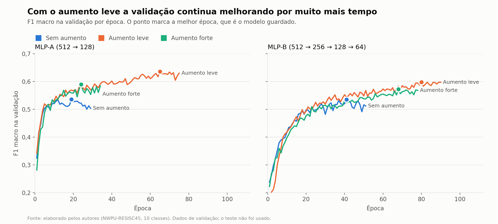
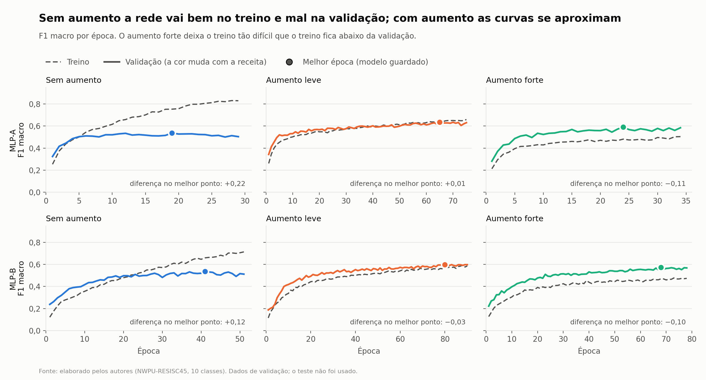
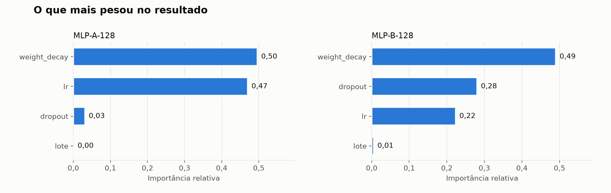

# MLP: o que foi usado em cada treino

Este documento resume, de forma simples, como as MLPs foram montadas e treinadas. O código está em `notebooks/02_mlp_preliminar.ipynb` e os números ficam em `resultados/`.

Foram **duas rodadas, com 6 treinos cada, no total de 12**:

- **1ª rodada (seções 1 a 8):** hiperparâmetros fixos escolhidos por nós (lr 0,0001, dropout 0,5, lote 64).
- **2ª rodada (seção 9):** os mesmos 6 treinos, repetidos com hiperparâmetros **achados pelo Optuna**.

> Todos os treinos aqui são **preliminares**. Só foram usados os dados de **treino** e de **validação**. O **teste não foi usado**.

---

## 1. Os dados

| Item | Valor |
|---|---|
| Imagens | 7.000, em 10 classes |
| Treino / validação / teste | 4.899 / 1.050 / 1.051 (o teste não foi usado) |
| Tamanho da imagem | 128 × 128, colorida (RGB) |
| Entrada da MLP | 49.152 números por imagem (128 × 128 × 3) |
| Preparação | valores divididos por 255 e ajustados com a média e o desvio do **treino** |

A MLP não enxerga a imagem como figura. Ela recebe todos os pixels em uma fila única de números.

---

## 2. As duas MLPs

As duas têm o mesmo tipo de camada. A diferença é o número de camadas.

| | MLP-A (mais simples) | MLP-B (mais profunda) |
|---|---|---|
| Camadas escondidas | 512 → 128 | 512 → 256 → 128 → 64 |
| Saída | 10 classes | 10 classes |
| Parâmetros | 25.234.570 | 25.341.386 |
| Dropout | 0,5 em **2** camadas | 0,5 em **4** camadas |

Cada camada escondida segue esta sequência: **Linear → BatchNorm → ReLU → Dropout (0,5)**. A camada de saída não tem dropout.

### Em quais camadas tem dropout

**MLP-A** (o dropout vem logo depois de cada camada escondida):

| Camada | Tamanho | Dropout |
|---|---|---|
| Entrada | 49.152 | não |
| Escondida 1 | 512 | **sim, 0,5** |
| Escondida 2 | 128 | **sim, 0,5** |
| Saída | 10 | não |

**MLP-B:**

| Camada | Tamanho | Dropout |
|---|---|---|
| Entrada | 49.152 | não |
| Escondida 1 | 512 | **sim, 0,5** |
| Escondida 2 | 256 | **sim, 0,5** |
| Escondida 3 | 128 | **sim, 0,5** |
| Escondida 4 | 64 | **sim, 0,5** |
| Saída | 10 | não |

Esse é o mesmo dropout nos seis primeiros treinos. Na 2ª rodada (seção 9) o Optuna escolhe outro valor.

---

## 3. O que cada peça faz

- **Dropout 0,5:** durante o treino, desliga metade dos neurônios ao acaso. Ajuda a rede a não "decorar" as imagens. Na validação ele fica desligado.
- **BatchNorm:** mantém os valores entre as camadas numa faixa estável, o que deixa o treino mais fácil.
- **ReLU:** passo que permite à rede aprender padrões que não são retas.
- **Weight decay:** uma pequena multa para pesos muito grandes, também contra a memorização.
- **Parada antecipada:** o treino para sozinho quando 10 épocas seguidas não melhoram o resultado.
- **F1 macro:** nota média das 10 classes. É a nota principal que usamos para escolher o melhor momento do treino.

---

## 4. Como foi o treino (igual nos 6 primeiros treinos)

| Item | Valor |
|---|---|
| Otimizador | Adam |
| Velocidade de aprendizado (lr) | 0,0001 |
| Weight decay | 0,0001 |
| Dropout | 0,5 em todas as camadas escondidas (MLP-A: 512 e 128; MLP-B: 512, 256, 128 e 64). A saída não tem |
| Imagens por lote | 64 |
| Limite de épocas | 200 |
| Parada antecipada | 10 épocas sem melhora no F1 macro da validação |
| Modelo guardado | o da época com maior F1 macro na validação |
| Sorteio (semente) | 42 |
| Computador | Mac, usando o chip Apple (MPS) |

---

## 5. Os 6 primeiros treinos

A única diferença entre eles é o **aumento de dados**, que cria variações das imagens de treino. Ele é usado **só no treino**, nunca na validação.

| # | Nome | Dropout | Aumento de dados | Já rodou? |
|---|---|---|---|---|
| 1 | `MLP-A-128_preliminar` | 0,5 nas camadas de 512 e 128 | nenhum | sim |
| 2 | `MLP-B-128_preliminar` | 0,5 nas camadas de 512, 256, 128 e 64 | nenhum | sim |
| 3 | `MLP-A-128_aug_preliminar` | 0,5 nas camadas de 512 e 128 | **leve**: espelhar e girar a imagem de 90 em 90 graus | sim |
| 4 | `MLP-B-128_aug_preliminar` | 0,5 nas camadas de 512, 256, 128 e 64 | **leve**: o mesmo do item 3 | sim |
| 5 | `MLP-A-128_aug2_preliminar` | 0,5 nas camadas de 512 e 128 | **forte**: o leve, mais zoom, mudança de cor e retângulos apagados | sim |
| 6 | `MLP-B-128_aug2_preliminar` | 0,5 nas camadas de 512, 256, 128 e 64 | **forte**: o mesmo do item 5 | sim |

Nesta 1ª rodada o dropout **não muda** de um treino para o outro. Ele faz parte da MLP e vale 0,5 nos seis, em todas as camadas escondidas, e a camada de saída (10 classes) nunca tem dropout. Ele só age durante o treino e fica desligado na validação.

**Detalhes do aumento forte** (só nos treinos 5 e 6, que usam também o aumento leve):
- **Zoom:** recorta de 50% a 100% da imagem e amplia de volta ao tamanho original.
- **Cor:** brilho, contraste e saturação mudam até 20% para mais ou para menos.
- **Retângulo apagado:** em metade das imagens, um quadrado de 10% a 40% do lado fica cinza.

---

## 6. Resultados (dados de validação)

| Treino | F1 macro | Acurácia | Épocas rodadas | Melhor época | Tempo |
|---|---|---|---|---|---|
| 1. MLP-A | 0,536 | 0,545 | 29 | 19 | 54 s |
| 2. MLP-B | 0,535 | 0,542 | 51 | 41 | 100 s |
| 3. MLP-A + aumento leve | **0,636** | **0,648** | 75 | 65 | 181 s |
| 4. MLP-B + aumento leve | 0,598 | 0,614 | 90 | 80 | 224 s |
| 5. MLP-A + aumento forte | 0,590 | 0,605 | 34 | 24 | 128 s |
| 6. MLP-B + aumento forte | 0,573 | 0,599 | 78 | 68 | 348 s |

O modelo guardado de cada treino é o da **melhor época** (coluna "Melhor época"), e não o da época em que o treino parou.

### Sobreajuste (decorar em vez de aprender)

Comparamos a nota no treino com a nota na validação, no melhor momento. Quanto maior a diferença, mais a rede decorou.

| Treino | Diferença (treino − validação) |
|---|---|
| 1. MLP-A | +0,22 (decorou bastante) |
| 2. MLP-B | +0,12 |
| 3. MLP-A + aumento leve | +0,01 (quase nada) |
| 4. MLP-B + aumento leve | −0,03 (nada) |
| 5. MLP-A + aumento forte | −0,11 (treino abaixo da validação) |
| 6. MLP-B + aumento forte | −0,10 (treino abaixo da validação) |

Nos treinos com aumento forte a nota do treino ficou **abaixo** da nota da validação. Isso acontece porque o treino ficou difícil demais: a rede passou a ter dificuldade até com as imagens que treina, e a nota do treino ainda é medida com o dropout e o aumento ligados.

---

## 7. O que dá para concluir

- O **aumento leve ajudou bastante**: a nota subiu de 6 a 10 pontos e quase acabou o "decorar".
- O **aumento forte ajudou menos que o leve**. Ficou acima dos treinos sem aumento (0,590 e 0,573 contra 0,536 e 0,535), mas **abaixo do aumento leve** (perdeu 4,6 pontos na MLP-A e 2,5 na MLP-B).
- Com o aumento forte o treino ficou **difícil demais**: a nota do treino caiu para cerca de 0,47 e 0,48. Passar do ponto de dificultar não compensa.
- Sem aumento, a MLP-A e a MLP-B ficaram praticamente **empatadas**. Mais camadas não ajudaram.
- Entre os seis primeiros, a melhor é a **MLP-A com aumento leve** (F1 macro 0,636).
- Ordem das seis, da melhor para a pior: MLP-A leve (0,636), MLP-B leve (0,598), MLP-A forte (0,590), MLP-B forte (0,573), MLP-A (0,536) e MLP-B (0,535).
- O aumento forte também **custou mais tempo** por época (cerca de 3,8 s na MLP-A e 4,5 s na MLP-B, contra 2,4 s com o aumento leve).

### Cuidados

- Cada treino foi feito **uma vez só**. A diferença de uns 4 pontos entre A e B com aumento pode ter um pouco de sorte.
- Os números são da **validação**. O desempenho final só aparece no teste, que vem depois.

---

## 8. Gráficos para comparar os seis treinos

Os gráficos ficam em `resultados/figuras/mlp/` e são gerados pela seção 10 do notebook. Nas cores, **azul é sem aumento, laranja é aumento leve e verde é aumento forte**.

### 8.1 Qual treino foi melhor

O aumento leve (laranja) ganhou nas duas MLPs.

### 8.2 Por quanto tempo cada treino continuou melhorando

Sem aumento (azul), a nota para de subir cedo. Com o aumento leve (laranja), ela continua subindo por muito mais tempo. O ponto marca a melhor época, que é o modelo guardado.

### 8.3 Treino contra validação, época por época

A linha tracejada é o treino e a linha colorida é a validação. Sem aumento, o treino sobe e a validação fica para trás. Com o aumento leve, as duas andam juntas. Com o aumento forte, o treino fica abaixo da validação.

### 8.4 A distância entre treino e validação

O círculo vazio é a nota no treino e o cheio é a nota na validação. Quanto mais longe um do outro, mais a rede se ajustou ao treino. O número da direita é essa diferença.

### 8.5 Tempo de treino contra nota

Treinar por mais tempo não deu um modelo melhor: o treino mais demorado (MLP-B com aumento forte, 348 s) ficou abaixo do melhor (MLP-A com aumento leve, 181 s).

---

## 9. Segunda rodada: hiperparâmetros achados pelo Optuna

Na 1ª rodada nós escolhemos os valores de treino. Aqui deixamos o **Optuna** procurar valores melhores e **repetimos os mesmos 6 treinos** com eles. Os treinos da 1ª rodada **não foram apagados nem alterados**. Os arquivos novos têm `_opt` no nome.

### 9.1 O que é o Optuna

É uma biblioteca que testa várias combinações de valores e usa o resultado de cada teste para escolher o próximo. Testes que vão mal logo no começo são cortados (poda), o que economiza tempo. Conta como **busca adicional**, separada dos treinos finais do projeto. Quem decide qual combinação é melhor é o **F1 macro na validação**. O teste **não é usado**.

### 9.2 Como foi a busca

| Item | Valor |
|---|---|
| Buscas | uma para a MLP-A e uma para a MLP-B |
| Tentativas por MLP | 20 |
| Limite de épocas por tentativa | 60 (com a mesma parada antecipada, 10 épocas sem melhora) |
| Aumento de dados nas tentativas | leve (espelhar e girar), a receita que foi melhor na 1ª rodada |
| Tentativas concluídas / cortadas | MLP-A: 8 / 12. MLP-B: 11 / 9 |
| Tempo da busca (neste Mac) | MLP-A: cerca de 29 minutos. MLP-B: cerca de 46 minutos |

O que o Optuna podia mudar:

| O quê | Faixa testada |
|---|---|
| Velocidade de aprendizado (lr) | 0,00001 a 0,003 |
| Weight decay | 0,000001 a 0,01 |
| Dropout | 0,2 a 0,7 |
| Imagens por lote | 32, 64 ou 128 |

As camadas das MLPs **não mudaram**. Só mudou o jeito de treinar e o valor do dropout.

### 9.3 Valores que o Optuna escolheu

| | 1ª rodada (nossos valores) | MLP-A (Optuna) | MLP-B (Optuna) |
|---|---|---|---|
| lr | 0,0001 | 0,00115 | 0,00020 |
| Weight decay | 0,0001 | 0,000007 | 0,000002 |
| Dropout | 0,5 | **0,3** | **0,2** |
| Imagens por lote | 64 | 128 | 128 |

O dropout continua nas **mesmas camadas escondidas** de antes (MLP-A: 512 e 128; MLP-B: 512, 256, 128 e 64) e a saída continua sem dropout. Só o valor mudou: 0,3 na MLP-A e 0,2 na MLP-B, nos três treinos de cada uma.

Em resumo: o Optuna preferiu **menos dropout**, **muito menos weight decay** e **lote maior**. A MLP-A aceitou um lr bem maior que o nosso.

**O que mais pesou no resultado** (nota de importância do Optuna):

| | MLP-A | MLP-B |
|---|---|---|
| Weight decay | 0,50 | 0,49 |
| lr | 0,47 | 0,22 |
| Dropout | 0,03 | 0,28 |
| Lote | 0,00 | 0,01 |

O **weight decay** e o **lr** foram o que mais mexeu na nota. O tamanho do lote quase não fez diferença.

### 9.4 Os 6 treinos repetidos

Cada MLP usou os valores da **sua** busca, nas mesmas três receitas de aumento de dados. Limite de 200 épocas e parada com 10 épocas sem melhora, como antes.

| Treino | F1 antes | F1 com Optuna | Ganho | Épocas rodadas | Melhor época | Tempo |
|---|---|---|---|---|---|---|
| MLP-A | 0,536 | 0,572 | +0,036 | 18 | 8 | 37 s |
| MLP-A + aumento leve | 0,636 | **0,675** | +0,039 | 65 | 55 | 108 s |
| MLP-A + aumento forte | 0,590 | 0,653 | +0,063 | 51 | 41 | 134 s |
| MLP-B | 0,535 | 0,541 | +0,006 | 19 | 9 | 27 s |
| MLP-B + aumento leve | 0,598 | 0,673 | +0,075 | 66 | 56 | 114 s |
| MLP-B + aumento forte | 0,573 | **0,679** | +0,106 | 75 | 65 | 220 s |

Todos os seis melhoraram. As acuracias ficaram entre 0,559 e 0,692.

### 9.5 Sobreajuste na 2ª rodada

Diferença entre a nota no treino e na validação, no melhor ponto:

| Treino | Antes | Com Optuna |
|---|---|---|
| MLP-A | +0,22 | +0,12 |
| MLP-A + aumento leve | +0,01 | +0,05 |
| MLP-A + aumento forte | −0,11 | −0,08 |
| MLP-B | +0,12 | +0,16 |
| MLP-B + aumento leve | −0,03 | +0,07 |
| MLP-B + aumento forte | −0,10 | −0,08 |

- Sem aumento, a rede continua **decorando** (+0,12 e +0,16), e o treino para cedo, na época 8 ou 9. O Optuna melhorou pouco esses dois treinos.
- Com aumento leve, a diferença subiu um pouco (de perto de zero para +0,05 e +0,07). Como o dropout ficou menor, a rede se ajusta mais ao treino, e mesmo assim a **validação subiu**.
- Com aumento forte, o treino continua abaixo da validação, mas bem menos (−0,08, antes −0,11 e −0,10). O treino ficou menos difícil demais.

### 9.6 O que dá para concluir da 2ª rodada

- O Optuna **ajudou em todos os treinos**. O ganho foi de 0,6 a 10,6 pontos de F1.
- O maior ganho foi no **aumento forte**. Com os valores antigos ele perdia para o aumento leve. Com os do Optuna, na MLP-B ele passou o aumento leve (0,679 contra 0,673).
- Os **três melhores treinos ficaram quase empatados**: MLP-B + aumento forte (0,679), MLP-A + aumento leve (0,675) e MLP-B + aumento leve (0,673). A diferença é de 0,6 ponto, e cada treino foi feito **uma vez só**. Não dá para dizer com segurança qual é o melhor.
- Sem aumento de dados, o ganho do Optuna foi pequeno. O **aumento de dados** continua sendo o que mais ajuda.
- O número de camadas (A contra B) continua não fazendo grande diferença.
- A busca foi feita **com aumento leve**. O treino sem aumento e o com aumento forte usaram os mesmos valores, que podem não ser os ideais para eles. Isso pode ter favorecido o aumento leve, e o aumento forte mostrou que ainda tinha folga.

### Cuidados

- Os números são da **validação**. O desempenho final só aparece no teste.
- Como o Optuna escolheu valores olhando a validação, a nota de validação dos treinos escolhidos pode estar um pouco otimista.
- A busca tem poucas tentativas (20 por MLP). Uma busca maior poderia achar valores um pouco melhores.

### 9.7 Gráficos da 2ª rodada

**Antes e depois do Optuna:**

Cinza são os valores da 1ª rodada e colorido são os do Optuna. O número acima de cada par é o ganho.

**A busca:**

Cada ponto azul é uma tentativa concluída, cada cinza foi cortada, e a linha laranja é a melhor nota até aquele momento. As duas buscas acharam o melhor valor cedo, mas continuaram testando.

---

## 10. Onde ficam os arquivos

| O quê | Onde |
|---|---|
| Código e explicações | `notebooks/02_mlp_preliminar.ipynb` |
| Tabela de todos os treinos (os 12) | `resultados/experimentos.csv` |
| Nota por época de cada treino | `resultados/historicos/` |
| Gráficos de treino e validação | `resultados/figuras/mlp/` |
| Configuração de cada treino | `resultados/configs/` |
| Modelos guardados | `modelos/` |
| Busca do Optuna: tentativas, melhores valores | `resultados/optuna/` (`tentativas_MLP-A-128.csv`, `tentativas_MLP-B-128.csv`, `melhores_hiperparametros.json`) |
| Gráficos da busca | `resultados/figuras/mlp/` (`optuna_historico.png`, `optuna_importancia.png`, `comparacao_6_optuna_antes_depois.png`) |

Os 6 treinos da 2ª rodada têm `_opt` no nome, por exemplo `MLP-A-128_aug_opt_preliminar`.
