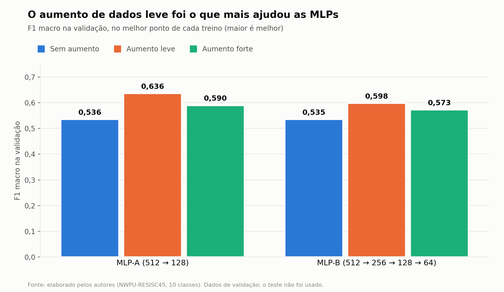
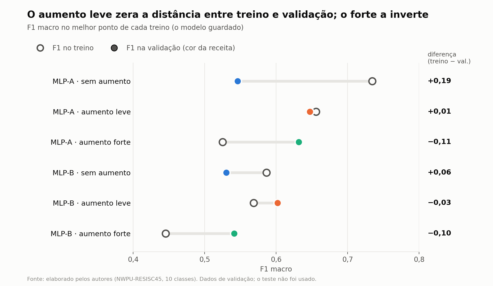
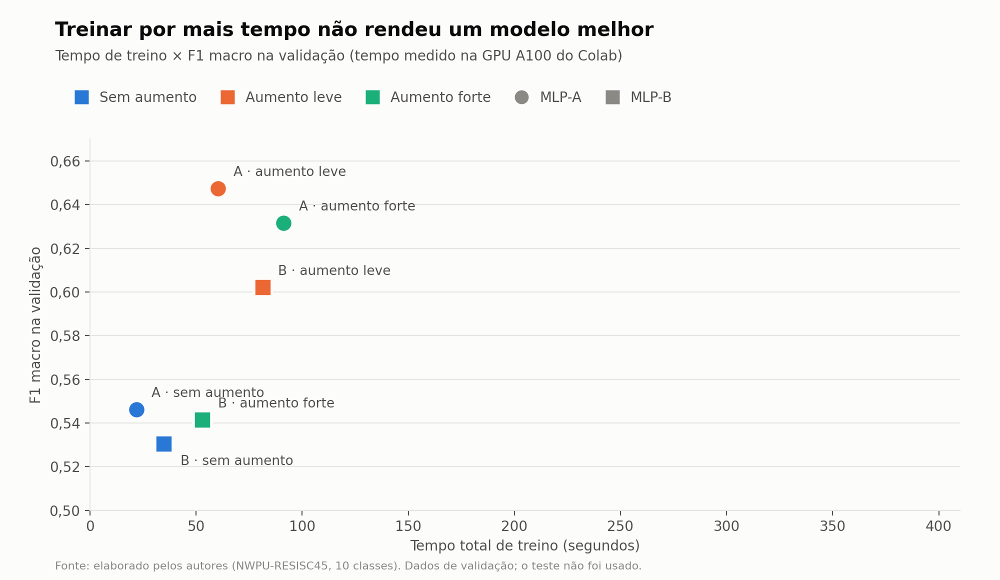
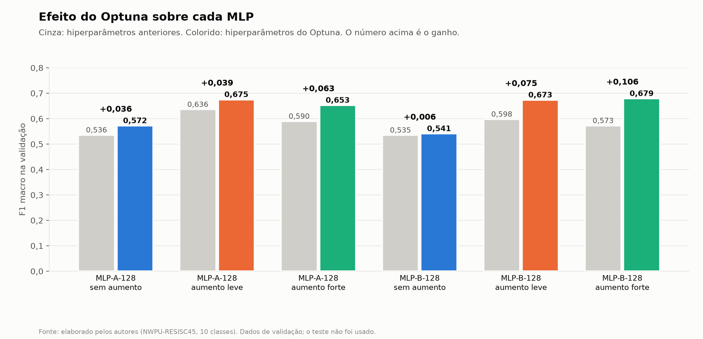
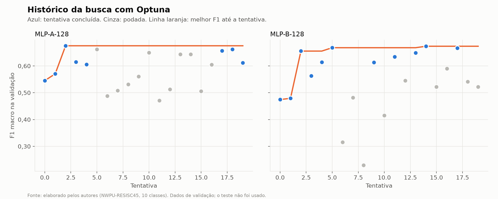

# MLP: o que foi usado em cada treino

Este documento resume, de forma simples, como as MLPs foram montadas e treinadas. O código está em `notebooks/02_mlp_preliminar.ipynb` e `src/`, e os números ficam em `resultados/`.

Foram **duas rodadas, com 6 treinos cada, no total de 12**:

- **1ª rodada (seções 1 a 8):** hiperparâmetros fixos escolhidos por nós (lr 0,0001, dropout 0,5, lote 64).
- **2ª rodada (seção 9):** os mesmos 6 treinos, repetidos com hiperparâmetros **achados pelo Optuna**.

> **Atualização: os 12 treinos foram refeitos na GPU A100 do Colab**, o mesmo hardware das CNNs e do YOLO (o PDF pede para preservar o hardware). A receita é a mesma da primeira execução: mesmo código, mesma semente (42) e mesmos hiperparâmetros, incluindo os do Optuna. **A busca do Optuna não foi refeita**: só o retreino com os valores já achados. Os arquivos e resultados que vieram do Mac foram **substituídos** pelos da A100. Os números do Mac ficam na seção 11, para comparação.

> Todos os treinos aqui são **preliminares**. Só foram usados os dados de **treino** e de **validação**. O **teste não foi usado**.

---

## 1. Os dados

| Item | Valor |
|---|---|
| Imagens | 7.000, em 10 classes |
| Treino / validação / teste | 4.899 / 1.050 / 1.051 (o teste não foi usado) |
| Tamanho da imagem | 128 × 128, colorida (RGB) |
| Entrada da MLP | 49.152 números por imagem (128 × 128 × 3) |
| Preparação | valores divididos por 255 e ajustados com a média e o desvio do **treino** |

A MLP não enxerga a imagem como figura. Ela recebe todos os pixels em uma fila única de números.

---

## 2. As duas MLPs

As duas têm o mesmo tipo de camada. A diferença é o número de camadas.

| | MLP-A (mais simples) | MLP-B (mais profunda) |
|---|---|---|
| Camadas escondidas | 512 → 128 | 512 → 256 → 128 → 64 |
| Saída | 10 classes | 10 classes |
| Parâmetros | 25.234.570 | 25.341.386 |
| Dropout | 0,5 em **2** camadas | 0,5 em **4** camadas |

Cada camada escondida segue esta sequência: **Linear → BatchNorm → ReLU → Dropout (0,5)**. A camada de saída não tem dropout.

### Em quais camadas tem dropout

**MLP-A** (o dropout vem logo depois de cada camada escondida):

| Camada | Tamanho | Dropout |
|---|---|---|
| Entrada | 49.152 | não |
| Escondida 1 | 512 | **sim, 0,5** |
| Escondida 2 | 128 | **sim, 0,5** |
| Saída | 10 | não |

**MLP-B:**

| Camada | Tamanho | Dropout |
|---|---|---|
| Entrada | 49.152 | não |
| Escondida 1 | 512 | **sim, 0,5** |
| Escondida 2 | 256 | **sim, 0,5** |
| Escondida 3 | 128 | **sim, 0,5** |
| Escondida 4 | 64 | **sim, 0,5** |
| Saída | 10 | não |

Esse é o mesmo dropout nos seis primeiros treinos. Na 2ª rodada (seção 9) o Optuna escolhe outro valor.

---

## 3. O que cada peça faz

- **Dropout 0,5:** durante o treino, desliga metade dos neurônios ao acaso. Ajuda a rede a não "decorar" as imagens. Na validação ele fica desligado.
- **BatchNorm:** mantém os valores entre as camadas numa faixa estável, o que deixa o treino mais fácil.
- **ReLU:** passo que permite à rede aprender padrões que não são retas.
- **Weight decay:** uma pequena multa para pesos muito grandes, também contra a memorização.
- **Parada antecipada:** o treino para sozinho quando 10 épocas seguidas não melhoram o resultado.
- **F1 macro:** nota média das 10 classes. É a nota principal que usamos para escolher o melhor momento do treino.

---

## 4. Como foi o treino (igual nos 6 primeiros treinos)

| Item | Valor |
|---|---|
| Otimizador | Adam |
| Velocidade de aprendizado (lr) | 0,0001 |
| Weight decay | 0,0001 |
| Dropout | 0,5 em todas as camadas escondidas (MLP-A: 512 e 128; MLP-B: 512, 256, 128 e 64). A saída não tem |
| Imagens por lote | 64 |
| Limite de épocas | 200 |
| Parada antecipada | 10 épocas sem melhora no F1 macro da validação |
| Modelo guardado | o da época com maior F1 macro na validação |
| Sorteio (semente) | 42 |
| Computador | GPU NVIDIA A100-SXM4-40GB (Google Colab), PyTorch 2.14.1 + CUDA 13.0 |

O tempo é medido no laço de treino e validação por época, sem o carregamento dos dados.

---

## 5. Os 6 primeiros treinos

A única diferença entre eles é o **aumento de dados**, que cria variações das imagens de treino. Ele é usado **só no treino**, nunca na validação.

| # | Nome | Dropout | Aumento de dados |
|---|---|---|---|
| 1 | `MLP-A-128_preliminar` | 0,5 nas camadas de 512 e 128 | nenhum |
| 2 | `MLP-B-128_preliminar` | 0,5 nas camadas de 512, 256, 128 e 64 | nenhum |
| 3 | `MLP-A-128_aug_preliminar` | 0,5 nas camadas de 512 e 128 | **leve**: espelhar e girar a imagem de 90 em 90 graus |
| 4 | `MLP-B-128_aug_preliminar` | 0,5 nas camadas de 512, 256, 128 e 64 | **leve**: o mesmo do item 3 |
| 5 | `MLP-A-128_aug2_preliminar` | 0,5 nas camadas de 512 e 128 | **forte**: o leve, mais zoom, mudança de cor e retângulos apagados |
| 6 | `MLP-B-128_aug2_preliminar` | 0,5 nas camadas de 512, 256, 128 e 64 | **forte**: o mesmo do item 5 |

Nesta 1ª rodada o dropout **não muda** de um treino para o outro. Ele faz parte da MLP e vale 0,5 nos seis, em todas as camadas escondidas, e a camada de saída (10 classes) nunca tem dropout. Ele só age durante o treino e fica desligado na validação.

**Detalhes do aumento forte** (só nos treinos 5 e 6, que usam também o aumento leve):
- **Zoom:** recorta de 50% a 100% da imagem e amplia de volta ao tamanho original.
- **Cor:** brilho, contraste e saturação mudam até 20% para mais ou para menos.
- **Retângulo apagado:** em metade das imagens, um quadrado de 10% a 40% do lado fica cinza.

---

## 6. Resultados (dados de validação)

| Treino | F1 macro | Acurácia | Épocas rodadas | Melhor época | Tempo |
|---|---|---|---|---|---|
| 1. MLP-A | 0,546 | 0,554 | 27 | 17 | 22 s |
| 2. MLP-B | 0,531 | 0,551 | 41 | 31 | 35 s |
| 3. MLP-A + aumento leve | **0,647** | **0,661** | 75 | 65 | 60 s |
| 4. MLP-B + aumento leve | 0,602 | 0,612 | 92 | 82 | 82 s |
| 5. MLP-A + aumento forte | 0,632 | 0,650 | 94 | 84 | 91 s |
| 6. MLP-B + aumento forte | 0,541 | 0,570 | 50 | 40 | 53 s |

O modelo guardado de cada treino é o da **melhor época** (coluna "Melhor época"), e não o da época em que o treino parou.

### Sobreajuste (decorar em vez de aprender)

Comparamos a nota no treino com a nota na validação, no melhor momento. Quanto maior a diferença, mais a rede decorou.

| Treino | Diferença (treino − validação) |
|---|---|
| 1. MLP-A | +0,19 (decorou bastante) |
| 2. MLP-B | +0,06 |
| 3. MLP-A + aumento leve | +0,01 (quase nada) |
| 4. MLP-B + aumento leve | −0,03 (nada) |
| 5. MLP-A + aumento forte | −0,11 (treino abaixo da validação) |
| 6. MLP-B + aumento forte | −0,10 (treino abaixo da validação) |

Nos treinos com aumento forte a nota do treino ficou **abaixo** da nota da validação. Isso acontece porque o treino ficou difícil demais: a nota do treino ainda é medida com o dropout e o aumento ligados.

---

## 7. O que dá para concluir

- O **aumento leve ajudou nas duas MLPs**: a nota subiu 10,1 pontos na MLP-A e 7,2 na MLP-B, e o "decorar" quase acabou.
- O **aumento forte ajudou a MLP-A** (+8,6 pontos sobre nenhum aumento), mas ficou abaixo do leve (−1,6 ponto). Na **MLP-B quase não ajudou** (+1,1 ponto) e ficou 6,1 pontos abaixo do leve.
- Com o aumento forte o treino ficou **difícil demais** para a MLP-B: a nota do treino caiu para cerca de 0,45. Passar do ponto de dificultar não compensa.
- Ordem dos seis, da melhor para a pior: MLP-A leve (0,647), MLP-A forte (0,632), MLP-B leve (0,602), MLP-A (0,546), MLP-B forte (0,541) e MLP-B (0,531).
- Com hiperparâmetros fixos, a **MLP-A foi igual ou melhor que a MLP-B nas três receitas**. Mais camadas não ajudaram.
- Entre os seis primeiros, a melhor é a **MLP-A com aumento leve** (F1 macro 0,647).

### Cuidados

- Cada treino foi feito **uma vez só**. A seção 11 mostra que repetir a receita em outro hardware muda o F1 em até 4,7 pontos, então diferenças de 2 a 3 pontos entre receitas podem ser sorte.
- Os números são da **validação**. O desempenho final só aparece no teste, que vem depois.

---

## 8. Gráficos para comparar os seis treinos

Os gráficos ficam em `resultados/figuras/mlp/` e são gerados por `src/graficos_mlp.py`. Nas cores, **azul é sem aumento, laranja é aumento leve e verde é aumento forte**.

### 8.1 Qual treino foi melhor

O aumento leve (laranja) ganhou nas duas MLPs.

### 8.2 Por quanto tempo cada treino continuou melhorando

Sem aumento (azul), a nota para de subir cedo. Com o aumento leve (laranja), ela continua subindo por muito mais tempo. O ponto marca a melhor época, que é o modelo guardado.

### 8.3 Treino contra validação, época por época

A linha tracejada é o treino e a linha colorida é a validação. Sem aumento, o treino sobe e a validação fica para trás. Com o aumento leve, as duas andam juntas. Com o aumento forte, o treino fica abaixo da validação.

### 8.4 A distância entre treino e validação

O círculo vazio é a nota no treino e o cheio é a nota na validação. Quanto mais longe um do outro, mais a rede se ajustou ao treino. O número da direita é essa diferença.

### 8.5 Tempo de treino contra nota

Treinar por mais tempo não deu um modelo melhor: o treino mais demorado (MLP-A com aumento forte, 91 s) ficou abaixo do melhor (MLP-A com aumento leve, 60 s). O tempo foi medido na A100.

---

## 9. Segunda rodada: hiperparâmetros achados pelo Optuna

Na 1ª rodada nós escolhemos os valores de treino. Aqui deixamos o **Optuna** procurar valores melhores e **repetimos os mesmos 6 treinos** com eles. Os arquivos novos têm `_opt` no nome.

### 9.1 O que é o Optuna

É uma biblioteca que testa várias combinações de valores e usa o resultado de cada teste para escolher o próximo. Testes que vão mal logo no começo são cortados (poda), o que economiza tempo. Conta como **busca adicional**, separada dos treinos finais do projeto. Quem decide qual combinação é melhor é o **F1 macro na validação**. O teste **não é usado**.

### 9.2 Como foi a busca

A busca foi feita **uma vez, no Mac** (primeira execução), e **não foi refeita na A100**. Os arquivos da busca (`resultados/optuna/tentativas_MLP-*.csv`, `melhores_hiperparametros.json`, `optuna_historico.png` e `optuna_importancia.png`) são os dessa busca no Mac. Só os retreinos foram refeitos na A100.

| Item | Valor |
|---|---|
| Buscas | uma para a MLP-A e uma para a MLP-B |
| Tentativas por MLP | 20 |
| Limite de épocas por tentativa | 60 (com a mesma parada antecipada, 10 épocas sem melhora) |
| Aumento de dados nas tentativas | leve (espelhar e girar), a receita que foi melhor na 1ª rodada |
| Tentativas concluídas / cortadas | MLP-A: 8 / 12. MLP-B: 11 / 9 |
| Tempo da busca (no Mac) | MLP-A: cerca de 29 minutos. MLP-B: cerca de 46 minutos |

O que o Optuna podia mudar:

| O quê | Faixa testada |
|---|---|
| Velocidade de aprendizado (lr) | 0,00001 a 0,003 |
| Weight decay | 0,000001 a 0,01 |
| Dropout | 0,2 a 0,7 |
| Imagens por lote | 32, 64 ou 128 |

As camadas das MLPs **não mudaram**. Só mudou o jeito de treinar e o valor do dropout.

### 9.3 Valores que o Optuna escolheu

| | 1ª rodada (nossos valores) | MLP-A (Optuna) | MLP-B (Optuna) |
|---|---|---|---|
| lr | 0,0001 | 0,00115 | 0,00020 |
| Weight decay | 0,0001 | 0,000007 | 0,000002 |
| Dropout | 0,5 | **0,3** | **0,2** |
| Imagens por lote | 64 | 128 | 128 |

O dropout continua nas **mesmas camadas escondidas** de antes e a saída continua sem dropout. Só o valor mudou: 0,3 na MLP-A e 0,2 na MLP-B, nos três treinos de cada uma.

Em resumo: o Optuna preferiu **menos dropout**, **muito menos weight decay** e **lote maior**. A MLP-A aceitou um lr bem maior que o nosso.

**O que mais pesou no resultado** (nota de importância do Optuna, da busca no Mac):

| | MLP-A | MLP-B |
|---|---|---|
| Weight decay | 0,50 | 0,49 |
| lr | 0,47 | 0,22 |
| Dropout | 0,03 | 0,28 |
| Lote | 0,00 | 0,01 |

O **weight decay** e o **lr** foram o que mais mexeu na nota. O tamanho do lote quase não fez diferença.

### 9.4 Os 6 treinos repetidos (na A100)

Cada MLP usou os valores da **sua** busca, nas mesmas três receitas de aumento de dados. Limite de 200 épocas e parada com 10 épocas sem melhora, como antes.

| Treino | F1 antes | F1 com Optuna | Ganho | Acurácia | Épocas rodadas | Melhor época | Tempo |
|---|---|---|---|---|---|---|---|
| MLP-A | 0,546 | 0,566 | +0,020 | 0,569 | 26 | 16 | 16 s |
| MLP-A + aumento leve | 0,647 | 0,682 | +0,034 | 0,686 | 65 | 55 | 41 s |
| MLP-A + aumento forte | 0,632 | **0,699** | +0,068 | 0,711 | 101 | 91 | 75 s |
| MLP-B | 0,531 | 0,545 | +0,014 | 0,552 | 21 | 11 | 14 s |
| MLP-B + aumento leve | 0,602 | **0,700** | +0,098 | 0,707 | 94 | 84 | 64 s |
| MLP-B + aumento forte | 0,541 | 0,696 | +0,155 | 0,708 | 105 | 95 | 84 s |

Todos os seis melhoraram. As acurácias ficaram entre 0,552 e 0,711.

### 9.5 Sobreajuste na 2ª rodada

Diferença entre a nota no treino e na validação, no melhor ponto:

| Treino | Antes | Com Optuna |
|---|---|---|
| MLP-A | +0,19 | +0,28 |
| MLP-A + aumento leve | +0,01 | +0,05 |
| MLP-A + aumento forte | −0,11 | −0,09 |
| MLP-B | +0,06 | +0,20 |
| MLP-B + aumento leve | −0,03 | +0,09 |
| MLP-B + aumento forte | −0,10 | −0,08 |

- **Sem aumento, a rede decora ainda mais** com os valores do Optuna (+0,28 e +0,20), e o melhor ponto aparece cedo, na época 16 ou 11 (o treino encerra 10 épocas depois). Com menos dropout e pouco weight decay, a rede se ajusta mais ao treino.
- Com aumento leve, a diferença subiu um pouco (de perto de zero para +0,05 e +0,09), e mesmo assim a **validação subiu**.
- Com aumento forte, o treino continua abaixo da validação, mas bem menos.

### 9.6 O que dá para concluir da 2ª rodada

- O Optuna **ajudou em todos os treinos**. O ganho foi de 1,4 a 15,5 pontos de F1.
- O maior ganho foi no **aumento forte**. Com os valores antigos ele perdia para o leve. Com os do Optuna, na MLP-A ele passou o leve (0,699 contra 0,682) e na MLP-B ficou praticamente empatado (0,696 contra 0,700).
- Os **três melhores treinos ficaram quase empatados**: MLP-B + aumento leve (0,700), MLP-A + aumento forte (0,699) e MLP-B + aumento forte (0,696). A diferença é de 0,4 ponto, e cada treino foi feito **uma vez só**. Não dá para dizer com segurança qual é o melhor.
- Sem aumento de dados, o ganho do Optuna foi pequeno. O **aumento de dados** continua sendo o que mais ajuda.
- O número de camadas (A contra B) não faz grande diferença.
- A busca foi feita **com aumento leve**. O treino sem aumento e o com aumento forte usaram os mesmos valores, que podem não ser os ideais para eles.

### Cuidados

- Os números são da **validação**. O desempenho final só aparece no teste.
- Como o Optuna escolheu valores olhando a validação, a nota de validação dos treinos escolhidos pode estar um pouco otimista.
- A busca tem poucas tentativas (20 por MLP) e foi feita em outro hardware (Mac) que o dos retreinos (A100).

### 9.7 Gráficos da 2ª rodada

**Antes e depois do Optuna:**

Cinza são os valores da 1ª rodada e colorido são os do Optuna. O número acima de cada par é o ganho.

**A busca (feita no Mac):**

Cada ponto azul é uma tentativa concluída, cada cinza foi cortada, e a linha laranja é a melhor nota até aquele momento.

---

## 10. Erros por classe e matrizes de confusão

As matrizes (reais nas linhas, previstas nas colunas, com contagens e normalizadas pela classe real) e as métricas por classe são calculadas **na validação**, a partir dos checkpoints salvos, para os 12 treinos. Uma figura por treino fica em `resultados/figuras/mlp/matrizes/`, e há uma grade com as seis matrizes de cada rodada (`resumo_matrizes_inicial.png` e `resumo_matrizes_optuna.png`).

**F1 médio por classe (média dos 12 treinos)**

| Classe | F1 médio |
|---|---|
| desert | 0,855 |
| forest | 0,811 |
| beach | 0,774 |
| harbor | 0,673 |
| dense_residential | 0,606 |
| circular_farmland | 0,598 |
| storage_tank | 0,581 |
| river | 0,562 |
| airport | 0,361 |
| mountain | 0,335 |

- **`desert` é a melhor classe nos 12 treinos.** `mountain` é a pior em 9 e `airport` em 3. É diferente do que se vê nas CNNs, onde `airport` é a pior em 30 dos 32 modelos e `desert` fica abaixo de várias classes. Uma hipótese (não testada) é que, sem a estrutura espacial, a MLP se apoie em cor e textura média, e `desert` seja a classe mais uniforme nisso.
- Com os pixels achatados, as classes que dependem de forma e arranjo espacial (`airport`, `mountain`, `river`) são as que a MLP mais erra.

**Melhor MLP (MLP-B com aumento leve e Optuna), por classe (validação, 105 imagens por classe)**

| Classe | Precisão | Recall | F1 |
|---|---|---|---|
| airport | 0,576 | 0,467 | 0,516 |
| beach | 0,853 | 0,829 | 0,841 |
| circular_farmland | 0,704 | 0,657 | 0,680 |
| dense_residential | 0,702 | 0,762 | 0,731 |
| desert | 0,880 | 0,905 | 0,892 |
| forest | 0,718 | 0,971 | 0,826 |
| harbor | 0,725 | 0,752 | 0,738 |
| mountain | 0,582 | 0,438 | 0,500 |
| river | 0,617 | 0,629 | 0,623 |
| storage_tank | 0,651 | 0,657 | 0,654 |
| **macro** | **0,701** | **0,707** | **0,700** |

**Pares de classes mais confundidos nesse modelo** (real → prevista, contagem): `mountain → forest` (18), `airport → storage_tank` (15), `circular_farmland → river` (12), `mountain → circular_farmland` (12), `mountain → river` (12) e `river → forest` (12). São confusões entre classes de textura natural parecida (`mountain`, `forest`, `river`, `circular_farmland`) e entre `airport` e `storage_tank` (superfícies planas com estruturas pequenas).

**Divisões por zero:** não ocorreram. Em nenhum dos 12 treinos alguma classe ficou sem previsões (a menor precisão por classe foi 0,267 e o menor recall foi 0,114), então precisão e recall estão definidos sempre. O cálculo usa `zero_division=0` por precaução.

---

## 11. Comparação com a execução anterior (Mac)

Os 12 treinos foram feitos primeiro no Mac (chip Apple, MPS) e depois refeitos na A100, com a mesma receita, a mesma semente e os mesmos hiperparâmetros.

| Treino | F1 Mac | F1 A100 | Diferença | Épocas (Mac / A100) | Tempo (Mac / A100) |
|---|---|---|---|---|---|
| MLP-A | 0,536 | 0,546 | +1,0 | 29 / 27 | 54 s / 22 s |
| MLP-B | 0,535 | 0,531 | −0,5 | 51 / 41 | 100 s / 35 s |
| MLP-A + leve | 0,636 | 0,647 | +1,1 | 75 / 75 | 181 s / 60 s |
| MLP-B + leve | 0,598 | 0,602 | +0,4 | 90 / 92 | 224 s / 82 s |
| MLP-A + forte | 0,590 | 0,632 | +4,2 | 34 / 94 | 128 s / 91 s |
| MLP-B + forte | 0,573 | 0,541 | −3,1 | 78 / 50 | 348 s / 53 s |
| MLP-A (Optuna) | 0,572 | 0,566 | −0,7 | 18 / 26 | 37 s / 16 s |
| MLP-A + leve (Optuna) | 0,675 | 0,682 | +0,7 | 65 / 65 | 108 s / 41 s |
| MLP-A + forte (Optuna) | 0,653 | 0,699 | +4,7 | 51 / 101 | 134 s / 75 s |
| MLP-B (Optuna) | 0,541 | 0,545 | +0,4 | 19 / 21 | 27 s / 14 s |
| MLP-B + leve (Optuna) | 0,673 | 0,700 | +2,7 | 66 / 94 | 114 s / 64 s |
| MLP-B + forte (Optuna) | 0,679 | 0,696 | +1,7 | 75 / 105 | 220 s / 84 s |

- A diferença média é de **+1,0 ponto** (A100 melhor), mas a diferença **absoluta** média é de 1,7 pontos, e vai de −3,1 a +4,7.
- Os maiores desvios estão nos treinos com **aumento forte**, em que a parada antecipada mudou muito de época (por exemplo MLP-A forte: parou na época 34 no Mac e na 94 na A100).
- **Isso mede o quanto uma execução única oscila.** Mesmo código, semente e hiperparâmetros dão F1 diferentes em outro hardware, porque a aleatoriedade do dropout e do aumento vem do gerador da GPU, e as contas numéricas também diferem. Não é um erro: é ruído de execução única. Por isso, **diferenças de 2 a 3 pontos entre receitas não são conclusivas** com uma execução por modelo.
- Nas CNNs, repetir os treinos **na mesma A100** reproduziu exatamente o F1, a acurácia e a época do checkpoint (duas execuções). Para as MLPs não repetimos na A100, mas é de se esperar que o ruído venha principalmente da troca de hardware e não de sorte entre execuções iguais.
- Quanto ao custo: a A100 treinou em média **2,7 vezes mais rápido no total** e **3,0 vezes mais rápido por época** que o Mac.
- A ordem das MLPs mudou um pouco: no Mac a melhor era a MLP-B + aumento forte com Optuna (0,679), e na A100 é a MLP-B + aumento leve com Optuna (0,700).

---

## 12. Comparação com as CNNs e o YOLO

Agora tudo roda na **mesma A100**, então o tempo é comparável. Melhor modelo de cada família (validação, uma execução):

| Família | Melhor modelo | F1 macro | Acurácia | Parâmetros | Tempo de treino |
|---|---|---|---|---|---|
| **YOLO** (pré-treinado) | YOLO26n-cls, 256 | **0,9895** | 0,9895 | 1,54 M | 243 s |
| **CNN (VGG16)** | VGG16SE, 256, aumento forte, Optuna | 0,9695 | 0,9695 | 14,80 M | 1.501 s |
| **CNN (ResNet18)** | ResNet18, 256, aumento forte, inicial | 0,9514 | 0,9514 | 11,18 M | 183 s |
| **MLP** | MLP-B, 128, aumento leve, Optuna | 0,7000 | 0,7067 | 25,34 M | 64 s |

- A melhor CNN fica **27,0 pontos acima** da melhor MLP (e a melhor CNN com aumento leve, 0,9645, fica 26,5 acima). A MLP é a mais barata de treinar, mas é a que menos rende: trata a imagem como uma fila de pixels, sem estrutura espacial.
- A MLP tem **mais parâmetros** que qualquer CNN ou o YOLO, porque quase todos estão na primeira camada (49.152 × 512).
- O YOLO é pré-treinado e usa outra receita (aumento de dados mais forte e otimizador automático), então a comparação não isola a arquitetura. Detalhes em `docs/YOLO.md`. As CNNs (96 treinos, com três receitas de aumento de dados) estão em `docs/CNN.md`.
- A MLP só existe em 128 × 128; as CNNs foram treinadas também em 256 × 256.

---

## 13. Onde ficam os arquivos

| O quê | Onde |
|---|---|
| Código e explicações | `notebooks/02_mlp_preliminar.ipynb` |
| Retreino na A100 e avaliação na validação | `src/rodar_mlps_a100.py` |
| Gráficos | `src/graficos_mlp.py` |
| Tabela de todos os treinos (os 12 das MLPs, junto com CNNs e YOLO) | `resultados/experimentos.csv` |
| Nota por época de cada treino | `resultados/historicos/` |
| Gráficos de treino e validação | `resultados/figuras/mlp/` |
| Matrizes de confusão (contagens) e figuras | `resultados/matrizes_confusao/` e `resultados/figuras/mlp/matrizes/` |
| Métricas por classe | `resultados/metricas_por_classe/` |
| Previsões na validação (arquivo, real, prevista, confiança) | `resultados/previsoes_validacao_mlp.csv` |
| Configuração de cada treino | `resultados/configs/` |
| Registro do treino na A100 | `resultados/treino_mlps_a100.log` |
| Modelos guardados (12 checkpoints, 1,2 GB, não versionados) | `modelos/` |
| Busca do Optuna: tentativas, melhores valores (feita no Mac) | `resultados/optuna/` (`tentativas_MLP-A-128.csv`, `tentativas_MLP-B-128.csv`, `melhores_hiperparametros.json`) |
| Gráficos da busca (feita no Mac) | `resultados/figuras/mlp/` (`optuna_historico.png`, `optuna_importancia.png`) |

Os 6 treinos da 2ª rodada têm `_opt` no nome, por exemplo `MLP-A-128_aug_opt_preliminar`.
